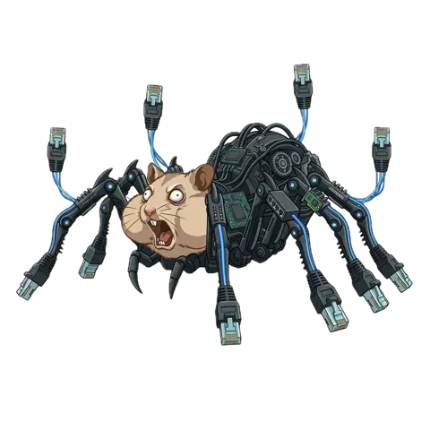

<p align="center">
  
</p>

<h1 align="center">Stashley</h1>

<p align="center">
  Dashboards, forms and table views on top of the MariaDB and MySQL databases you already have, for everyone who needs them and only what their role allows.
</p>

---

Your data already lives in a database. Stashley puts a friendly face on it, without moving it anywhere: connect a database, share the tables and views you want with an upper limit of what may be done with them, and build pages from queries and tables. People sign in and find the pages of their roles: a cash desk that records payments, a check-in list, a dashboard with today's numbers, a guest list for each hotel.

- **Admins** connect databases, share tables and views, manage accounts and sign-in (passwords, two-factor authentication, OIDC), the REST API and the instance.
- **Managers** build pages from queries and shared tables, grant rights to roles within the admin's limits, and preview a page as a role before publishing it.
- **Users** work with the pages of their roles, nothing more.

Security rests on the privileges of the database users. Stashley adds its own checks on top: every query is validated before it is stored, and the browser only ever runs stored components, never SQL of its own. Stashley runs as one Docker container with an embedded metadata store.

Supported databases: MariaDB 10.11, 11.4, 11.8 and 12.3; MySQL 8.4 and 9.7.

## Documentation

| You want to | Read |
| --- | --- |
| Install and operate an instance | [Admin guide](docs/admin/index.md) |
| Build pages, queries and forms | [Manager guide](docs/manager/index.md) |
| Connect an integration | [REST API](docs/api/index.md) |
| Try everything with sample data | [Demo](docs/demo.md) |

The guides are also published as a documentation site (`pnpm --filter @stashley/docs dev` runs it locally). Progress and decisions: [`PROGRESS.md`](PROGRESS.md); design: [`docs/architecture.md`](docs/architecture.md); changes per release: [`docs/CHANGELOG.md`](docs/CHANGELOG.md).

## Quick start

Requirements: Docker with Compose.

```bash
cp .env.example .env
```

Set `APP_SECRET_KEY` (for example with `openssl rand -base64 32`) and `APP_BASE_URL` in `.env`, then:

```bash
docker compose up -d
```

Stashley listens on port 8080. Put a reverse proxy with TLS in front of it for anything but local use. To look around with sample data first, follow the [demo](docs/demo.md): a hiking club with registrations, payments, hotels, check-in and stations.

## CSV import


**Design → Import** brings CSV files of up to 50 MB into shared tables: encoding, delimiter and formats are detected, columns are mapped by name, a dry run shows new, updated and faulty rows before anything is written, and the import runs in one transaction. Admins can also create a new table from a file. See [CSV import](docs/manager/imports.md).

<br clear="right">

## REST API



Integrations reach single shared tables under `/api/v1` with a token. The API is closed for every table until an admin opens operations on it, and tables appear under a name of their own, never their real one. Tokens carry their rights per resource and operation, an optional expiry date, allowed addresses and a rate limit. See the [REST API reference](docs/api/index.md).

<br clear="right">

```bash
curl -H "Authorization: Bearer stl_api_…" https://stashley.example.com/api/v1/payments?limit=100
```

## Operations

| Task | Command |
| --- | --- |
| Back up the metadata store | `docker compose exec stashley stashley backup` |
| Restore a backup (server stopped) | `docker compose run --rm stashley restore /data/backups/<file>.db` |
| Health | `GET /healthz` (process), `GET /readyz` (metadata store and migrations) |

All state lives in the `/data` volume. Do not place it on a network filesystem (NFS, SMB).

## Development

Requirements: Node.js 26 and pnpm 12.

```bash
pnpm install
```

```bash
pnpm check
```

| Command | Purpose |
| --- | --- |
| `pnpm --filter @stashley/server dev` | Server with reload (needs `APP_SECRET_KEY`, `APP_BASE_URL`, `STASHLEY_DATA_DIR`) |
| `pnpm --filter @stashley/web dev` | Web client dev server, proxies API calls to port 8080 |
| `pnpm build` | Build all packages |
| `scripts/build.sh` | Build the Docker image |
| `scripts/seed-demo.sh` | Start a MariaDB container with the demo database (see `docs/demo.md`) |
| `scripts/test-integration.sh` | Target database tests against MariaDB 10.11 and 12.3, MySQL 8.4 and 9.7 |
| `scripts/test-e2e.sh` | Playwright end-to-end suite in Docker (two instances, demo database, mock OIDC provider), removed afterwards |
| `scripts/load-test.sh` | k6 load test, 50 users on 2 vCPU / 2 GB; run after `scripts/test-e2e.sh --keep` |
| `pnpm --filter @stashley/docs dev` | Documentation site |

## How it all began

The origin story, in pure Gemini slop: written and drawn by an AI, accepted without review. The code gets a lot more scrutiny than this.

<table>
  <tr>
    <td width="50%" valign="top">
      
      <p><strong>1.</strong> Stashley has a strong nuts business going. He manages various food sources that are important to him.</p>
    </td>
    <td width="50%" valign="top">
      
      <p><strong>2.</strong> With time, his stash grows, and so do his responsibility and the effort to keep track of it.</p>
    </td>
  </tr>
  <tr>
    <td width="50%" valign="top">
      
      <p><strong>3.</strong> So Stashley builds himself a headquarters, from where he can oversee and manage his stash.</p>
    </td>
    <td width="50%" valign="top">
      
      <p><strong>4.</strong> Stashley now feels confident that he always knows what is going on in his stash.</p>
    </td>
  </tr>
</table>

## License

Stashley is free software under the [GNU Affero General Public License v3.0 only](LICENSE). Every instance links to its source code in the **About** dialog.
