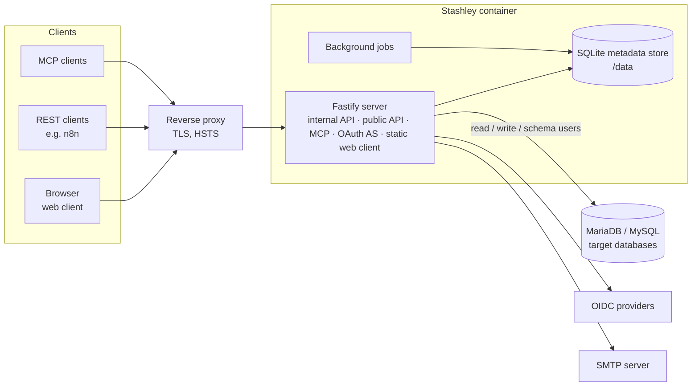
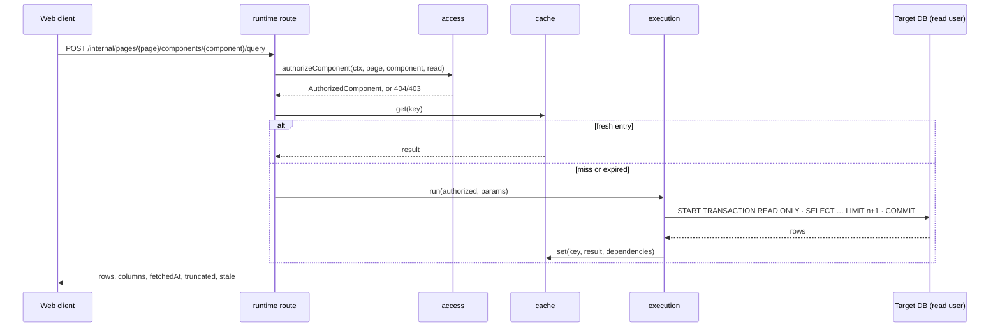
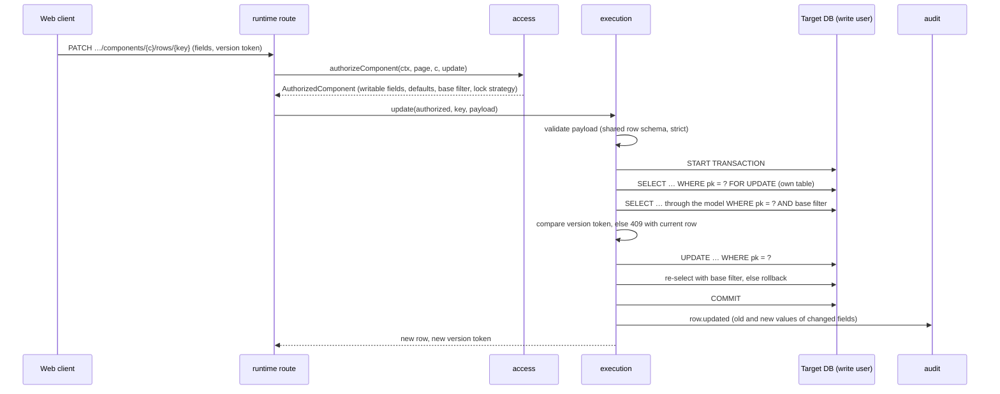

# Stashley architecture

> Status: approved on 2026-11-12 (milestone M0). Later changes to this document are recorded in [`PROGRESS.md`](../PROGRESS.md).

## Contents

1. [Purpose and principles](#1-purpose-and-principles)
2. [Glossary](#2-glossary)
3. [System context](#3-system-context)
4. [Repository layout](#4-repository-layout)
5. [Server structure](#5-server-structure)
6. [Process lifecycle and configuration](#6-process-lifecycle-and-configuration)
7. [Metadata store](#7-metadata-store)
8. [Access control](#8-access-control)
9. [Target databases](#9-target-databases)
10. [Read path](#10-read-path)
11. [Write path](#11-write-path)
12. [Query cache](#12-query-cache)
13. [Pages and components](#13-pages-and-components)
14. [HTTP conventions](#14-http-conventions)
15. [Internal API](#15-internal-api)
16. [Public REST API](#16-public-rest-api)
17. [CSV import](#17-csv-import)
18. [MCP server and authorization server](#18-mcp-server-and-authorization-server)
19. [Authentication and accounts](#19-authentication-and-accounts)
20. [Audit log and application logs](#20-audit-log-and-application-logs)
21. [Secrets and cryptography](#21-secrets-and-cryptography)
22. [Web client](#22-web-client)
23. [CLI](#23-cli)
24. [Configuration export and import](#24-configuration-export-and-import)
25. [Build, container and release](#25-build-container-and-release)
26. [Test strategy](#26-test-strategy)
27. [Milestone mapping](#27-milestone-mapping)
28. [Decisions requiring approval](#28-decisions-requiring-approval)
29. [Resolved questions](#29-resolved-questions)

---

## 1. Purpose and principles

Stashley connects to existing MariaDB and MySQL databases. On top of them it lets you build dashboards, forms and table views, and serves each one to users according to their roles. It ships as a single Docker image under AGPL-3.0-only.

Every module follows these principles:

1. **The server decides.** The server authorizes every read and every write, on every request. The web client only hides what the server has already refused.
2. **No generic data access.** The internal API runs only stored components of pages, addressed by page ID and component ID. The public API serves only endpoints an admin has enabled. MCP serves only components of published pages.
3. **Database grants are the security boundary.** Stashley's own SQL checks are a second layer that produces precise error messages. They never replace least-privilege database users.
4. **Configuration produces SQL.** Reads come either from validated stored queries or from SQL generated for table sources. Writes are always generated from configuration. There is no free-form write SQL.
5. **One process, one volume.** Server, background jobs and web client run in one container. All state lives in `/data`.
6. **Portable metadata access.** All metadata store access goes through Kysely, so the store can later move to PostgreSQL or MariaDB.
7. **Field values stay out of logs.** Row data appears only in the audit log, never in application logs.

## 2. Glossary

These terms are used consistently in code, API and English UI.

| Term | Meaning |
| --- | --- |
| Connection | A configured target database (one schema) with up to three database users: read, write and schema. |
| Object | A table or view of a connection. |
| Table access | The admin's decision to make an object usable in Stashley. It carries the permission ceiling, excluded columns, key column, display template, API resource alias and MCP exposure. |
| Permission ceiling | The maximum set of operations (read, create, update, delete) allowed on an object. |
| System role | `admin`, `manager` or `user`. Every account has exactly one. |
| Role | A business role defined per instance. An account can have any number of roles. |
| Principal | A role, or the pseudo-principal `authenticated`, which stands for every signed-in account. |
| Section, page | A navigation group and its entries. A page is either a dashboard or a table page. |
| Component | An addressable unit of a page that touches data: a dashboard block, the main table of a table page, or a related table in a detail view. |
| Block | A component of a dashboard: `metric`, `chart`, `table`, `record`, `form` or `text`. |
| Data source | What a component reads or writes. It is either a query from the query library or a table source (an object plus its configuration). |
| Query, query library | Named, versioned, read-only SQL statements. |
| Page filter | A value the user selects that feeds parameters or columns of every component on a page. |
| Base filter | A fixed row restriction on a table source that users cannot remove. |
| Instance variable | A named, typed value that every query can use. |
| Display template | A template that renders a row as human-readable text. |
| Lookup column | A read-only column pulled from a related object over up to three relation steps. |
| Virtual relation | A relation the admin defines where the database has no foreign key. |
| Generated field | A form field whose value the server computes, such as an auto-increment ID or a date expression. |
| Default value | A field's initial value, taken from a constant, an instance variable, the user context, a page filter or a URL parameter. |
| Preview as role | Viewing a page with the rights of selected roles. Writes are disabled. |
| Metadata store | The embedded SQLite database that holds all configuration. |

## 3. System context



- TLS terminates at the reverse proxy, which also sets HSTS. `TRUST_PROXY` lists the proxy addresses allowed to set forwarded headers.
- Stashley opens outbound connections only to the configured target databases, OIDC providers, the SMTP server and MCP client metadata documents (§18.4).

## 4. Repository layout

```text
.
├── apps/
│   ├── server/                 # @stashley/server: Fastify API, CLI, background jobs
│   │   ├── src/
│   │   │   ├── main.ts         # entry point of `stashley serve`
│   │   │   ├── cli/            # CLI commands (§23)
│   │   │   ├── config/         # environment and *_FILE loading, validation
│   │   │   ├── platform/       # HTTP server, plugins, errors, logging, crypto, events, jobs
│   │   │   ├── metastore/      # Kysely instance, migrations, backup and restore
│   │   │   ├── target/         # MariaDB/MySQL adapters: pools, sessions, dialect, encoding, errors
│   │   │   └── modules/<name>/ # routes.ts, service.ts, repository.ts, *.test.ts
│   │   └── test/               # integration tests (metadata store, target database matrix)
│   └── web/                    # @stashley/web: React client
│       └── src/
│           ├── app/            # router, providers, application shell
│           ├── ui/             # design tokens and components built on React Aria Components
│           ├── features/       # workspace, design, admin, profile, auth, oauth
│           ├── blocks/         # block renderers and editors
│           ├── brand/          # logo and mascot assets (placeholder until delivered)
│           └── i18n/           # messages/en.json, messages/de.json
├── packages/
│   └── shared/                 # @stashley/shared: types, Zod schemas, access algebra
├── e2e/                        # @stashley/e2e: Playwright suites, fixtures, test environment
├── docs/                       # architecture, admin guide, manager guide, API reference, changelog
├── scripts/                    # build.sh, seed-demo.sh, repository checks
├── Dockerfile
├── docker-compose.yml
├── .env.example
├── .nvmrc
└── PROGRESS.md
```

- **Workspace:** pnpm workspaces. Every package is ESM. TypeScript runs with `strict`, `noUncheckedIndexedAccess` and `exactOptionalPropertyTypes`.
- **Node.js:** version 26, Active LTS since October 2026. It is pinned in `.nvmrc`, in `engines` and in the Dockerfile. Node 26 ships the Temporal API, which the server uses for all date and time arithmetic.
- **`packages/shared`** holds only code both sides need, with no I/O:
  - `access/`: the permission algebra (§8).
  - `model/`: Zod schemas for configuration documents (pages, blocks, forms, table sources, filters, query builder specs).
  - `api/`: internal API contracts and the error code catalog.
  - `values/`: column type mapping, value encoding, display formats, result-shape analysis, and the row schema builder for forms.
- **Server only:** SQL validation, SQL generation and anything that touches a database.
- **Source headers:** every source file starts with:

  ```text
  SPDX-FileCopyrightText: 2026 Stashley contributors
  SPDX-License-Identifier: AGPL-3.0-only
  ```

  A repository check enforces the header.

## 5. Server structure

### 5.1 Layers and dependency rules

```text
routes (Fastify + Zod)  →  services  →  repositories (Kysely → metadata store)
                                     →  target adapters (mysql2 / Kysely → target databases)
```

- **Routes** validate input, call a service and map the result. They contain no SQL and no business logic.
- **Module boundaries:** a module uses another module only through its service interface, never through its repository.
- **Database access:**
  - Only `execution` reads or writes rows in target databases.
  - `connections` and `catalog` read `information_schema` and grants.
  - Only `imports` uses the schema user.
- **Authorization before execution:** `execution` accepts only `AuthorizedComponent`, `AuthorizedFilter` and `AuthorizedEndpoint` values, and only `access` can create them (§8.4). A lint rule (`no-restricted-imports`) keeps every other module from importing `access/handles.ts` and `access/compile.ts`, except for types.
- **Wiring:** there is no DI framework. A composition root, `createServer(config, overrides?)`, wires the services, and Fastify decorators expose them to routes. Tests pass overrides.
- **Events:** modules publish typed in-process events that caches and compiled models listen to. Examples: `table-access.changed`, `catalog.refreshed`, `page.published`, `user.changed`, `variable.changed`, `rows.written`.

### 5.2 Modules

| Module | Responsibility | Milestone |
| --- | --- | --- |
| `system` | Health and readiness, instance settings, job scheduler, backups | M1 |
| `auth` | Sessions, local sign-in, TOTP, OIDC sign-in, CSRF, invitations, password reset | M2 |
| `users` | Accounts, lifecycle, system role, profile | M2 |
| `audit` | Audit events, retention, export | M2 (row writes from M6) |
| `connections` | Connections, encrypted credentials, TLS, pools, grant inspection, key rotation | M3 |
| `catalog` | Schema introspection, snapshots, diffs, drift detection | M3 |
| `table-access` | Table access, ceilings, column exclusions, view key columns, virtual relations, display templates, MCP exposure | M3 |
| `roles` | Roles, role assignment, home pages per role | M4 |
| `variables` | Instance variables | M4 |
| `queries` | Query library, versions, SQL validation, builder compiler, test runs | M4 (builder UI in M5) |
| `access` | Permission evaluation, authorized handles, permission overview | M4 |
| `cache` | Query cache, single-flight, invalidation index | M4 |
| `execution` | Query executor, table reader, lookups, write executor, error translation | M4 (reads), M6 (writes) |
| `pages` | Sections, pages, drafts, versions, publishing, preview | M4 (API), M5 (editor, versions, compare) |
| `runtime` | Component endpoints of the workspace (query, rows, options, export, refresh) | M4 (reads), M6 (writes, export) |
| `public-api` | REST endpoints, tokens, OpenAPI document | M7 |
| `imports` | CSV import into existing tables, table creation | M7 |
| `mcp` | OAuth authorization server, MCP transport and tools, consent, personal tokens, call log | M8 |
| `config-transfer` | Configuration export and import | M9 |

## 6. Process lifecycle and configuration

### 6.1 Environment

| Variable | Default | Notes |
| --- | --- | --- |
| `APP_SECRET_KEY` | none (required) | At least 32 bytes. The process refuses to start without it. Supports `_FILE`. |
| `APP_BASE_URL` | none (required) | Public URL, used for cookies, OIDC callbacks, OAuth issuer, links in emails. |
| `INITIAL_ADMIN_EMAIL`, `INITIAL_ADMIN_PASSWORD` | none | Read only while no admin exists. Password supports `_FILE`. |
| `SMTP_HOST`, `SMTP_PORT`, `SMTP_USER`, `SMTP_PASSWORD`, `SMTP_FROM` | none | Without SMTP, links are shown to the admin for copying. Password supports `_FILE`. |
| `TRUST_PROXY` | none | Comma-separated addresses or CIDRs passed to Fastify `trustProxy`. |
| `CACHE_MAX_MB` | `256` | Query cache size limit. |
| `LOG_LEVEL` | `info` | `debug`, `info`, `warn`, `error`. |
| `APP_TIMEZONE` | `UTC` | IANA zone for display and date expressions. |
| `PORT` | `8080` | Listening port. |
| `STASHLEY_PUBLIC_API` | `on` | `off` leaves the public REST API routes unregistered, so everything under `/api` answers `404` (E21). |
| `STASHLEY_IMPORT_CONCURRENCY`, `STASHLEY_IMPORT_PER_USER` | `2`, `1` | Dry runs and imports running at once per instance and per user (E27). |
| `STASHLEY_IMPORT_MAX_MB` | `50` | Largest CSV upload. Uploads are kept under `/data/uploads` for at most 24 h. |
| `STASHLEY_IMPORT_BATCH_SIZE` | `500` | Rows per batch of an import (§17). |

- **Secrets from files:** every secret variable also accepts a `_FILE` variant that points to a file, for Docker secrets.
- **Validation:** configuration is validated with Zod at startup. On failure the process exits and lists the variable names and reasons, never their values.
- **Runtime settings:** settings admins change while the instance runs live in the metadata store, not the environment. Examples: session timeouts, 2FA enforcement, retention, MCP.

### 6.2 Startup

1. Load and validate the configuration, then derive subkeys from `APP_SECRET_KEY` (§21.1).
2. Open `/data/stashley.db` with these pragmas: `journal_mode=WAL`, `synchronous=NORMAL`, `foreign_keys=ON`, `busy_timeout=5000`.
3. Check the filesystem type of `/data` with `fs.statfs`. On NFS or SMB/CIFS, log a warning and show a notice to admins.
4. If migrations are pending, write an online backup to `/data/backups/pre-migration-<from>-<to>-<timestamp>.db`, then run the migrations.
5. Verify the key check value (§21.1). If `APP_SECRET_KEY` changed without a rotation, the process exits with a clear message.
6. If no active admin exists and `INITIAL_ADMIN_*` is set, create the first admin.
7. Start the heartbeat (§23), start the jobs, start listening, and switch readiness to ready.

### 6.3 Health endpoints

| Endpoint | Returns 200 when |
| --- | --- |
| `/healthz` | The process is serving HTTP. |
| `/readyz` | Startup finished, migrations are applied, and `select 1` on the metadata store succeeds. Returns 503 during startup and shutdown. |

The Docker `HEALTHCHECK` runs `node /app/healthcheck.js`, a dependency-free script that calls `/healthz`, because the image contains no curl.

### 6.4 Graceful shutdown

On `SIGTERM` or `SIGINT` the server:

1. Switches readiness to not ready.
2. Stops accepting connections and lets in-flight requests finish, with a grace period of 30 s.
3. Stops jobs and rolls back unfinished target transactions.
4. Closes the target pools.
5. Runs `PRAGMA wal_checkpoint(TRUNCATE)` and closes the metadata store.
6. Exits with code 0.

Requests that are still running when the grace period ends are aborted.

### 6.5 Background jobs

An in-process scheduler runs the jobs and records the last run of each in `job_runs`, so intervals survive restarts.

| Job | Interval |
| --- | --- |
| Schema drift check per connection | 24 h |
| Audit log and MCP call log retention | daily |
| Automatic backup (if enabled, 14 kept) | daily |
| Expired uploads (older than 24 h) | hourly |
| Expired sessions, user tokens, OAuth records | hourly |
| API token usage counters (batched writes) | 10 s |

### 6.6 Data volume

```text
/data/stashley.db            metadata store (+ -wal, -shm)
/data/backups/               manual, automatic, pre-migration and pre-restore backups
/data/uploads/               CSV uploads, deleted after import or after 24 h
```

## 7. Metadata store

### 7.1 Conventions

- **Driver:** SQLite through better-sqlite3 and Kysely's `SqliteDialect`. Repositories are the only callers of Kysely.
- **Write transactions** start with `BEGIN IMMEDIATE`, through a helper, so they never hit lock-upgrade failures.
- **Portable column types:**
  - IDs are UUIDv7 strings generated in the application.
  - Timestamps are integers (milliseconds since the epoch, UTC).
  - Booleans are integers (0/1), mapped at the repository boundary.
  - JSON values are TEXT, validated with Zod on every read and write.
  - SQLite-specific SQL is allowed only in migrations, behind a dialect check.
- **Naming:** snake_case, plural table names, explicit foreign keys with `ON DELETE` rules.
- **Versioned documents:** JSON documents (page documents, builder specs) carry `schemaVersion` and are upgraded on read by upcaster functions.

### 7.2 Schema

The lists below give each table's columns. Encrypted columns use the format described in §21.2.

**Identity and sessions**

| Table | Purpose and main columns |
| --- | --- |
| `users` | `id`, `email` (unique, normalized), `display_name`, `system_role`, `status` (`pending`, `active`, `disabled`), `password_hash`, `totp_secret` (encrypted), `totp_enabled_at`, `locale`, `format_locale`, `theme`, `last_login_at`, timestamps |
| `user_recovery_codes` | `user_id`, `code_hash`, `used_at` |
| `user_identities` | `user_id`, `provider_id`, `subject`, `email`; unique (`provider_id`, `subject`) |
| `identity_providers` | `id`, `slug`, `display_name`, `issuer_url`, `client_id`, `client_secret` (encrypted), `scopes`, `auto_approve_domains` (JSON), `enabled`, `position` |
| `sessions` | `id_hash` (primary key), `user_id`, `state` (`mfa_required`, `mfa_enrollment_required`, `active`), `auth_method`, `csrf_secret`, `created_at`, `last_active_at`, `expires_at`, `ip`, `user_agent` |
| `user_tokens` | One-time tokens. `user_id`, `purpose` (`invitation`, `password_reset`), `token_hash`, `expires_at`, `consumed_at`, `created_by` |
| `roles` | `id`, `name` (unique), `description`, `home_page_id`, `position`, timestamps |
| `user_roles` | `user_id`, `role_id` |

**Instance**

| Table | Purpose and main columns |
| --- | --- |
| `settings` | `key`, `value` (JSON, one Zod schema per key), `updated_by`, `updated_at`. Includes local sign-in, 2FA enforcement, manager role creation, session timeouts, retention, automatic backups, MCP settings and the key check value. |
| `instance_heartbeat` | Single row: `pid`, `started_at`, `heartbeat_at`. The CLI uses it to detect a running server. |
| `job_runs` | `name`, `last_started_at`, `last_finished_at`, `last_status`, `last_error_code` |

**Connections and catalog**

| Table | Purpose and main columns |
| --- | --- |
| `connections` | `id`, `name` (unique, also the reference in configuration exports), `host`, `port`, `database_name`, `engine` (`mariadb`, `mysql`), `server_version`, `tls` (JSON: mode, CA PEM, server name), `timezone` (IANA), `query_timeout_ms`, `schema_checked_at` and `schema_check_failure` (outcome of the last schema read), timestamps |
| `connection_credentials` | `id`, `connection_id`, `purpose` (`read`, `write`, `schema`; unique per connection), `username`, `password` (encrypted, AAD `connection_credentials:<id>:password`), `grant_report` (JSON), `checked_at` |
| `schema_snapshots` | `id`, `connection_id`, `captured_at`, `content_hash`, `content` (JSON, §9.3), `trigger` (`manual`, `scheduled`, `import`) |
| `schema_drifts` | `id`, `connection_id`, `snapshot_id`, `detected_at`, `diff` (JSON), `acknowledged_at`, `acknowledged_by` |

**Table access**

| Table | Purpose and main columns |
| --- | --- |
| `table_access` | `id`, `connection_id`, `object_name`, `object_type` (`table`, `view`), `ops` (bitmask), `key_column` (the primary key for tables, a chosen unique column for views, or null), `display_template`, `api_resource` (unique alias), `mcp_enabled`, `state` (`active`, `pending_grants`), timestamps; unique (`connection_id`, `object_name`) |
| `column_exclusions` | `table_access_id`, `column_name` (primary key together), `scope` (`all`, `mcp`; `all` wins) |
| `virtual_relations` | `id`, `connection_id`, `source_object`, `source_column`, `target_object`, `target_column`, `kind` (`many_to_one`, `one_to_one`) |

**Queries and variables**

| Table | Purpose and main columns |
| --- | --- |
| `queries` | `id`, `connection_id`, `name` (unique), `description`, `mode` (`builder`, `sql`), `cache_ttl_seconds` (0 means live), `latest_version`, `created_by`, timestamps, `archived_at` |
| `query_versions` | `query_id`, `version`, `sql_text`, `builder_spec` (JSON: the spec and the compiler's notes), `parameters` (JSON), `analysis` (JSON, §10.2), `executable` (JSON, §10.4), `result_columns` (JSON), `created_by`, `created_at`. Immutable. |
| `instance_variables` | `id`, `name` (unique, fixed once created), `type`, `value` (JSON), `description`, `updated_by`, timestamps |

**Pages**

| Table | Purpose and main columns |
| --- | --- |
| `sections` | `id`, `name`, `position`, timestamps |
| `pages` | `id`, `section_id`, `position`, `kind` (`dashboard`, `table`), `slug` (unique), `draft` (JSON page document), `draft_revision`, `draft_updated_by`, `draft_updated_at`, `published_version`, `created_at`, `archived_at` |
| `page_versions` | `page_id`, `version`, `document` (JSON with pinned query versions), `source_revision`, `published_by`, `published_at`. The last 20 per page are kept. |

**Public API**

| Table | Purpose and main columns |
| --- | --- |
| `api_endpoints` | `table_access_id`, `operation` (`list`, `get`, `count`, `create`, `update`, `replace`, `upsert`, `delete`, `schema`), `enabled_by`, `enabled_at` |
| `api_tokens` | `id`, `name`, `token_hash` (unique), `token_hint`, `expires_at`, `ip_allowlist` (JSON), `rate_limit_per_minute`, `created_by`, `created_at`, `updated_at`, `revoked_at`, `last_used_at`, `request_count` |
| `api_token_grants` | `token_id`, `table_access_id`, `operation` |

**Imports**

| Table | Purpose and main columns |
| --- | --- |
| `import_jobs` | `id`, `connection_id` and `table_access_id` (set once a target is chosen), `new_table` (JSON: definition, `skipFailed`, and how far creating it got), `mode` (`insert`, `upsert`, `create_table`), `upsert_key`, `file_name`, `file_sha256`, `file_size`, `encoding_detected`, `parse_options` (JSON), `mapping` (JSON), `status` (`uploaded`, `checking`, `checked`, `importing`, `completed`, `failed`, `cancelled`), `dry_run` (JSON: fingerprint, counts, at most 10,000 problems), `result` (JSON: counts or failure), `created_by`, `created_at`, `updated_at`, `finished_at`, `expires_at` (24 h) |

**MCP and OAuth**

| Table | Purpose and main columns |
| --- | --- |
| `oauth_records` | Storage adapter for `oidc-provider`: `model`, `id`, `payload` (JSON), `grant_id`, `uid`, `expires_at`, `consumed_at` |
| `mcp_notices` | `version`, `text`, `created_by`, `created_at` |
| `mcp_consents` | `id`, `user_id`, `client_id`, `client_name`, `notice_version`, `granted_at`, `revoked_at` |
| `mcp_tokens` | `id`, `user_id`, `name`, `token_hash`, `token_hint`, `notice_version`, `expires_at`, `created_at`, `last_used_at`, `revoked_at` |
| `mcp_calls` | `id`, `occurred_at`, `user_id`, `client_ref`, `tool`, `page_id`, `component_id`, `params` (JSON), `row_count`, `duration_ms`, `outcome` |

**Audit**

| Table | Purpose and main columns |
| --- | --- |
| `audit_events` | `id`, `occurred_at`, `actor_kind` (`user`, `api_token`, `mcp`, `system`, `cli`), `actor_id`, `actor_label`, `action`, `ip`, `subject_kind`, `subject_id`, `subject_label`, `page_id`, `component_id`, `connection_id`, `object_name`, `row_key`, `changes` (JSON), `details` (JSON) |

- **Audit immutability:** the repository offers only insert and query, and a trigger rejects `UPDATE` on `audit_events`. The retention job is the only code path that deletes rows.
- **Not persisted:** query caches and compiled page models live only in memory.

### 7.3 Migrations, backup and restore

- **Migrations:**
  - TypeScript modules in `apps/server/src/metastore/migrations/NNNN_<name>.ts`.
  - Registered through a static provider, so bundling works.
  - Applied automatically at startup and forward only; `down` exists for tests.
- **Backups:** created with the SQLite online backup API (`better-sqlite3` `backup()`). They are consistent while the server runs.
- **Restore** (`stashley restore <file>`) requires a stopped server (§23) and runs these steps:
  1. Check the file with `PRAGMA integrity_check`.
  2. Check that its migration version is not newer than the application.
  3. Copy the current database to `/data/backups/pre-restore-<timestamp>.db`.
  4. Replace the database file and remove the `-wal` and `-shm` files.

## 8. Access control

Access control is the central component. The algebra lives in `packages/shared/src/access` as pure functions. The server's `access` module wraps it and is the only place that grants access to data.

### 8.1 Layers

| Layer | Owner | Content |
| --- | --- | --- |
| Table access | Admin | Which objects exist for Stashley, their permission ceiling, excluded columns, MCP exposure |
| Page rights | Manager | Per page and principal: view, and per data source the operations read, create, update, delete |
| Component restrictions | Manager | Per component and principal: a subset of the page rights (can only narrow) |
| Database grants | DBA | Privileges of the read, write and schema users (from the grant report, §9.4) |

### 8.2 Model

```ts
type Op = 'read' | 'create' | 'update' | 'delete'
type OpSet = number                      // bitmask: read 1, create 2, update 4, delete 8
type Principal = RoleId | 'authenticated'
type SourceKey = `query:${QueryId}` | `table:${TableAccessId}`

interface PageAccess {
  view: Principal[]
  grants: { principal: Principal; source: SourceKey; ops: Op[] }[]
}

interface ComponentRestriction {         // absent principal: inherits the page rights
  principal: Principal
  ops: Op[]
}
```

- **Component capability** is what a component can do at all:

  | Component | Capability |
  | --- | --- |
  | Metric, chart, record, query table | `read` |
  | Table with a table source | `read`, plus the editing operations configured on it |
  | Form in create mode | `create` |
  | Form in edit mode | `read`, `update` |
  | Form in upsert mode | `create`, `update` |
  | Text block | No data source; shown whenever the page is visible |

- **Ceiling of a query source:** `read` if every object the query references has `read` in its ceiling, no referenced column is excluded, and no `*` reference covers an object with exclusions. Otherwise it is empty.

### 8.3 Evaluation

```text
principals(u)    = roles(u) ∪ {authenticated}               (preview: selected roles ∪ {authenticated})
pageOps(r, p, s) = r ∈ p.view ? grant(p, r, s) : ∅
compOps(r, k)    = pageOps(r, page(k), source(k)) ∩ restriction(k, r)   (restriction defaults to all ops)
effective(u, k)  = ( ⋃ over r ∈ principals(u) of compOps(r, k) )
                   ∩ capability(k) ∩ ceiling(source(k)) ∩ dbGrants(source(k))
```

- **Union, then intersection.** The union across principals comes first. Ceiling and grants do not depend on the principal, so intersecting them after the union gives the same result as intersecting per principal.
- **Delivery rule:** a component is delivered when `effective ∩ {read} ≠ ∅`, or when it is a form whose effective set contains its write operation. A form in edit mode needs both `read` and `update`.
- **Secondary sources** are lookup columns, display templates, foreign key option lists and page filter options. They are authorized through their primary:
  - Lookup columns, display templates and foreign key option lists use the right of the component they belong to.
  - A foreign key option list from a table shows every record of the target unless the field narrows it with its own base filter (`reference.baseFilter`, same value kinds as §13.1 base filters), e.g. to the kontingents of one hotel. Saving checks the value against the same conditions. Query option lists narrow themselves; only conditions on the user context or instance variables restrict, because page filter and URL values come from the client (E10).
  - Page filter options use the view right of the page.

  In every case each object involved must have `read` in its ceiling and none of the columns used may be excluded.
- **Display templates** are checked on save, whenever table access is listed, and again when a page is compiled, for stored and component templates alike. A stored template that no longer passes, because a column was excluded or removed or the target lost `read` or its table access, is flagged (`template_invalid`) and not used; the effective template falls back to the default, the first text column that is not excluded.
- **Changing a ceiling** takes effect on the next request through this formula. Nothing is rewritten in stored pages. Affected pages are flagged (§8.6).

### 8.4 Enforcement

Every data path passes through one of these functions of the `access` service:

| Function | Used by | Result |
| --- | --- | --- |
| `renderPage(ctx, pageId, mode)` | Workspace page delivery | Render model containing only delivered components, stripped of server-only configuration (SQL, base filter values, hidden defaults) |
| `authorizeComponent(ctx, pageId, componentId, op)` | Runtime routes, MCP | `AuthorizedComponent` |
| `authorizeFilter(ctx, pageId, filterId)` | Page filter options (D12) | `AuthorizedFilter` |
| `authorizeEndpoint(token, resource, operation)` | Public API | `AuthorizedEndpoint` |
| `authorizeDesign(ctx, action)` | Design and admin routes | Ensures the system role allows the action |

- **Authorized handles** (`AuthorizedComponent`, `AuthorizedEndpoint`) are branded types created by a factory private to the `access` module. They carry the resolved source, effective operations, writable fields, server-side default values, base filter and lock strategy. Everything in `execution` takes such a handle as its first argument, so unauthorized execution does not compile.
- **Unknown or invisible pages and components** return `404` on the internal API, which leaves nothing to probe for existence. Visible components without the requested operation return `403`.
- **Invalidation:** access facts (table access, grant reports, catalog, relations) and compiled pages are held in memory and rebuilt after the events of §5.1. The roles of a user are read on every request, and the session check runs first, so deactivating a user or changing their roles takes effect on the next request.

### 8.5 Modes

| Mode | Who | Principals | Reads | Writes |
| --- | --- | --- | --- | --- |
| `runtime` | Everyone | Own roles ∪ `authenticated` | Effective rights | Effective rights |
| `edit` | Admin, manager | n/a | Every component of the draft whose sources are within the ceiling and the database grants (`read`); the render model marks each component `readable` and lists its issues | Simulated against the ceiling (§11.2) |
| `preview` | Admin, manager | Selected roles ∪ `authenticated` | Effective rights of those roles | Simulated with the rights of those roles (§11.2) |

Admins and managers see every published page in navigation. In `runtime` mode their data rights still come only from their own roles.

### 8.6 Configuration checks and issues

- **On draft save and on publish**, the server rejects:
  - Grants that exceed the current ceiling.
  - Data sources that reference missing or unexposed objects.
  - Excluded columns.
  - Restrictions that are not subsets of the page rights.
- **Issues** are derived, never stored. The design UI shows them as markers. They are computed from the current table access, catalog and query analyses. Examples: a page whose grants now exceed a lowered ceiling, a block bound to a removed column, a query version that references a newly excluded column.
  - Each issue has a path into the document, a code and a severity. Errors block saving and publishing; warnings (missing database grants) do not.
  - Codes: `exceeds_ceiling`, `unknown_source`, `restriction_widens`, `unknown_role` (D15), `query_missing`, `version_missing`, `query_not_readable`, `object_not_exposed`, `object_not_readable`, `excluded_column`, `unknown_column`, `unknown_relation`, `template_*`, `parameter_not_bindable`, `unknown_input`, `duplicate`, `reserved`, `view_read_only`, `grant_missing` (warning).
  - A component whose source has an error is not delivered: its ceiling counts as empty. A base filter is never dropped; if one of its columns becomes unreadable, the component goes with it.
  - `GET /internal/design/issues` lists the issues of every draft and published version.

### 8.7 Permission overview

The admin overview is computed with the same algebra over every published page. It lists, per object: role → page → component → effective operations, plus MCP reachability (§18.3). It can be filtered by object, role and page.

## 9. Target databases

### 9.1 Connections and pools

- **Supported servers:** MariaDB 10.11, 11.4, 11.8 and 12.3, and MySQL 8.4 and 9.7.
  - Other versions can connect, but they produce a warning.
  - The engine and version are detected with `SELECT VERSION(), @@version_comment`.
- **Pools:** one `mysql2` pool per connection and purpose. Read pools allow 10 connections, write pools 4 and schema pools 1. Pools are created lazily, use idle timeouts, and are recreated when credentials change.
- **Client options:**
  - `multipleStatements: false`, `charset: utf8mb4`, `supportBigNumbers` and `bigNumberStrings`, `dateStrings`.
  - The client flag `FOUND_ROWS`, so `affectedRows` counts matched rows.
  - At most 128 prepared statements per connection (`maxPreparedStatements`); mysql2 closes the ones it evicts. Generated SQL varies with every filter combination, and mysql2's default of 16,000 per connection could fill the server-wide `max_prepared_stmt_count` for every client of the server.
  - A connect timeout of 10 s, and TLS from the connection settings (modes `disabled`, `required`, `verify-ca`, `verify-full`, optional CA PEM).
- **Generated SQL** is built and compiled with Kysely (`MysqlDialect`) and executed with bound parameters. Stored queries run as prepared statements (`execute`).
- **Self-connection guard:**
  - Only TCP is allowed; there is no socket path.
  - Before each pool is created, the host is resolved. Every address is normalized first, so IPv4-mapped IPv6 in any notation (`::ffff:7f00:1`) is checked as IPv4.
  - Only public, private (RFC 1918) and carrier-grade NAT IPv4 addresses, global unicast IPv6 (`2000::/3`) and unique local IPv6 (`fc00::/7`) are allowed. Everything else is rejected: loopback, unspecified, link-local, multicast, reserved and documentation ranges, and the IPv6 forms that can embed an IPv4 address (IPv4-compatible, NAT64, 6to4, Teredo). Addresses of the container's own interfaces are rejected too.
  - The check repeats whenever a pool is recreated, which defends against DNS rebinding. A pool whose address cannot be reached (`unreachable`, `timeout`) is dropped, so the next request resolves the host again, e.g. after a database container got a new address. Concurrent first requests share one pool.
  - A call that fails returns its connection only after `ROLLBACK`, so no caller inherits an open transaction; if that fails too, the connection is closed.
  - When a name resolves to several allowed addresses, IPv4 is used first: containers often have no IPv6 route, and the pinned socket cannot fall back to another address.
  - The socket connects to the address that was checked, while the driver keeps the host name, so TLS still verifies the certificate against the name (or the configured server name).
  - Integration tests on a developer machine reach databases through loopback; only the test server relaxes the check there (`STASHLEY_TEST_ALLOW_LOOPBACK`). CI runs them with the check on.
- **Stored passwords:** a test or save may leave a password empty to keep the stored one, but only while host, port and TLS settings (mode, CA, server name) are unchanged (`sameConnectionTarget` in `packages/shared`). With any other target, every password must be entered again, so stored passwords never reach a server they were not saved for. A test that uses stored passwords is audited as `connection.tested`.
- **Errors:** driver errors become a failure code (`unreachable`, `timeout`, `access_denied`, `unknown_database`, `tls_failed`, `host_not_allowed`, `failed`). Server messages are never logged or returned, because they can contain user names, addresses or values.

### 9.2 Session setup

| Pool | Statements run when a connection is created |
| --- | --- |
| All | `SET NAMES utf8mb4`, `SET time_zone = '+00:00'` |
| Read | `SET SESSION TRANSACTION READ ONLY`, the statement timeout (MariaDB `SET SESSION max_statement_time = <s>`, MySQL `SET SESSION max_execution_time = <ms>`), and the session `sql_mode` without `ANSI`, `ANSI_QUOTES`, `NO_BACKSLASH_ESCAPES`, `ORACLE`, `MSSQL`, `DB2`, `POSTGRESQL` and `MAXDB`, which change how quotes, strings or the grammar are read (§10.2) |
| Write | Adds `STRICT_ALL_TABLES` to the session `sql_mode`, so out-of-range or truncated values raise errors instead of warnings |

- **Read-only transactions:** every read still runs inside an explicit `START TRANSACTION READ ONLY` … `COMMIT` (§10.5).
- **Client-side timer:** the server timeout plus 2 s. When it fires, the server sends `KILL QUERY <thread id>` over a separate connection of the same user; the statement then fails as `query_timeout`. mysql2's own timeout, which drops the connection, follows 3 s later as the last resort.

### 9.3 Catalog

- **Introspection** runs with the read user, so the catalog contains exactly the objects that user can see. It reads these `information_schema` tables:
  - `TABLES`, `COLUMNS`, `STATISTICS` (primary and unique keys).
  - `KEY_COLUMN_USAGE` and `REFERENTIAL_CONSTRAINTS` (foreign keys with their `ON DELETE` and `ON UPDATE` actions; snapshots from before the actions were read compare without them).
  - `VIEWS` (definitions, which need `SHOW VIEW`).
  - On MySQL, also `VIEW_TABLE_USAGE`.
- **View dependencies:** on MariaDB, base tables are found by parsing view definitions with node-sql-parser, recursively through nested views. MariaDB stores definitions with nested parentheses the parser does not always accept; then the schema-qualified table names in the definition are used, which MariaDB always writes.
- **Key candidates** of a view are columns named like the single-column primary key of a base table (`id`) or `<table>_id`. The admin picks the key column; candidates are only suggestions.
- **Snapshot document:** for each object it records:
  - The type and the estimated row count.
  - Every column: name, position, data type, full column type, nullability, default, `auto_increment`, the `ON UPDATE` expression, length, precision and scale, enum or set values, generated flag. Only virtual and stored generated columns count as generated; MySQL's `DEFAULT_GENERATED` (an expression default such as `CURRENT_TIMESTAMP`) does not.
  - The primary key, unique keys and foreign keys. Prefix indexes (`name(10)`) and functional key parts do not count as unique keys.
  - For views: the base tables and the key candidate.
- **Diff:** a refresh compares the new snapshot with the stored one. It lists added, changed and removed objects and columns, and collects every affected query, component, relation, display template and API endpoint into an impact report.
- **Scheduled check:** every 24 h. If the diff is not empty, it is stored as a drift and shown to admins until one of them marks it as seen.
- **Snapshots:** a new one is stored only when the structure changed; row estimates are not part of the comparison. The last 20 per connection are kept, plus every snapshot an unacknowledged drift refers to.
- **Table access state:** after every read, exposed objects the read user no longer sees switch to `pending_grants`, and back to `active` when they reappear.
- **Check status:** every read, manual or scheduled, stores its time and failure code on the connection (`schema_checked_at`, `schema_check_failure`), so a failed daily check is shown on the connection page. The writes of a read (snapshot, drift, pruning, access states, type changes) run in one transaction.
- **View base tables** list only tables the read user sees; CTE names are left out. Without `SHOW VIEW` the definition is empty: the view gets `dependenciesKnown: false`, and its table access shows `view_dependencies_unknown`, because caches on it cannot follow writes to its tables (§12). A view key column that can be NULL shows `view_key_nullable`.
- **Virtual relations** need source and target columns of the same kind of value (integers, text, …). A view's key column cannot change while a relation relies on it.
- **Type changes:** when an exposed table is replaced by a view of the same name, the table access becomes a view and its ceiling drops to `read`; a former view gets the table's single-column primary key as key column. Both are audited (`table_access.type_changed`) and appear in the impact list as `type_changed`.

### 9.4 Grant inspection

- **When:** on save and on demand, for each credential.
- **How:** on a connection that is closed afterwards, the server runs `SHOW GRANTS`. Both engines list what a session of the user gets at sign-in: its own privileges, its active roles with their nested roles and, on MariaDB 11.1 and later, `PUBLIC`. The output is parsed into global, schema, table and column privileges.
- **The report contains:**
  - **Required privileges:** for read, `SELECT` (`SHOW VIEW` is checked per exposed view, §9.3); for write, `SELECT`, `INSERT`, `UPDATE` and optionally `DELETE`; for schema, `CREATE` and `INSERT`.
  - **Missing privileges.**
  - **Excess privileges, shown as warnings:** any global privilege other than `USAGE`; access to other schemas; `DROP`, `ALTER`, `FILE`, `GRANT OPTION`, `SUPER`, `PROCESS`, `CREATE USER`, `RELOAD`, `SHUTDOWN`, `EXECUTE`, routine, trigger and event privileges; write privileges on the read user; `ALTER` or `DROP` on the schema user.
- **Effect on access:** per object, the report feeds `dbGrants` in §8.3. If the write user lacks `DELETE` on a table, delete is never offered there; every write also needs `SELECT`: creates read their row back (base filter, answer, dry run), updates and deletes find their row by key. MySQL partial revokes (`REVOKE … ON db.*` against a global privilege) are taken off. Column-level privileges count for the object, and writable fields stay within the granted columns (E6). The table access API shows these as `grantedOps` next to the ceiling, and the columns the write user may insert and update as `writableColumns` (null where its privilege covers the whole object).
- **Grant options:** `WITH GRANT OPTION` on privileges and `WITH ADMIN OPTION` on roles are warnings (`grant_option`).
- **Roles:** Stashley never runs `SET ROLE` in its pools, so only roles active at sign-in (`CURRENT_ROLE()`) count for required, missing and granted privileges.
  - Granted roles that are inactive at sign-in are read for warnings: MySQL with `SET ROLE ALL` and `SHOW GRANTS` (which also covers `mandatory_roles`), MariaDB with `SET ROLE <role>` and `SHOW GRANTS FOR CURRENT_ROLE` per role (which includes nested roles). MariaDB refuses `SHOW GRANTS FOR <role>` for roles that are not active.
  - Every inactive role gets the warning `inactive_role`. A role whose grants cannot be read gets `role_unreadable` instead of being skipped.
- **Parsing:** the report never stores raw grant lines except unrecognized ones, and `IDENTIFIED BY …` clauses are removed first. Schema patterns with an unescaped `%` count as access to other schemas.
- **Account:** the report records `CURRENT_USER()` (`stashley_read@%`), so statements can name the account. Reports stored before that lack it until the grants are checked again.
- **User scopes** (`GET /internal/admin/connections/:id/read-scope` and `…/write-scope`): the SQL validation (§10.2) keeps unexposed objects and excluded columns out of stored queries, and the write path (§11) writes only what the table access allows. A user with privileges on the whole schema could still do more. To let the database enforce exposures, exclusions and ceilings as well:
  - Table access shows `excluded_column_readable` when the read user may select a column excluded for everyone, `excluded_column_writable` when the write user may insert or update one, and `write_beyond_ceiling` when the write user may insert, update or delete beyond the ceiling (on views: any write).
  - Table access shows `excluded_column_required` when `create` is in the ceiling but an excluded column is `NOT NULL` without default (and neither auto-increment nor generated): no insert can leave it out.
  - Each scope lists the objects the user may select without being exposed for it, the readable excluded columns and, for the write user, write privileges beyond the ceiling. Objects the read user cannot see are missing from the catalog; grants on them still count, because the grant report names them.
  - It suggests `REVOKE` and `GRANT` statements:
    - Read user: `SELECT` on each exposed object with `read`, and `SHOW VIEW` on views.
    - Write user: `SELECT` on each exposed object with any operation, because writes check rows before and after, also through the joins of a base filter. On tables, `INSERT`, `UPDATE` and `DELETE` as far as the ceiling allows.
    - On objects with exclusions, `SELECT (<columns>)` covers only the other columns, and the write user's `INSERT (<columns>)` and `UPDATE (<columns>)` every other column that is not generated (E6). Objects without exclusions keep privileges on the whole object, so new columns need no new statements.
    - Nothing is limited per component: one write user serves every page, and the fields of all pages change with each publish. Tried on both engines: `ON UPDATE CURRENT_TIMESTAMP` needs no privilege on its column, unnamed columns get their defaults, and a named column without privilege fails with 1143.
    - Privileges on every database and privileges from roles cannot be narrowed this way; notes say so.
  - With column grants the read user no longer sees the excluded columns, so they also leave the catalog. Their exclusions stay stored and may be saved again; new exclusions still need a column in the catalog. New tables show up only once the read user may read them.

### 9.5 Value encoding

The rules are defined once in `packages/shared/src/values` and used by every surface.

| SQL type | JSON value |
| --- | --- |
| `TINYINT(1)`, `BOOLEAN` | boolean |
| Other integers except `BIGINT` | number |
| `BIGINT`, `DECIMAL` | string (canonical, no exponent) |
| `FLOAT`, `DOUBLE` | number |
| `DATE` | `"YYYY-MM-DD"` |
| `DATETIME` | ISO 8601 UTC (`…Z`); the stored wall time is read in the connection time zone |
| `TIMESTAMP` | ISO 8601 UTC (the session time zone is `+00:00`) |
| `TIME` | `"HH:MM:SS[.ffffff]"` |
| `YEAR` | number |
| `CHAR`, `VARCHAR`, `TEXT`, `ENUM` | string |
| `SET` | array of strings |
| `JSON` | string with the raw JSON text (the driver runs with `jsonStrings`) |
| `BLOB`, `BINARY`, `VARBINARY`, spatial types | Never selected. The column metadata marks them as unsupported, and tables show a placeholder. |

- **Writes** convert the other way: a UTC instant becomes the connection's wall time for `DATETIME`, using Temporal with `compatible` disambiguation.
- **Invalid dates** read from legacy data (zero dates, or impossible dates such as `2025-02-30` written with `ALLOW_INVALID_DATES`) become `null` and the row gets a flag.

## 10. Read path



### 10.1 Query library

- **Identity and versions:** a query belongs to one connection and has a unique name. Saving a changed query creates a new immutable version.
- **Pinning:** publishing a page pins the current version of each query it uses. A later edit to the query reaches users only when an affected page is published again. The query editor lists those pages.
- **Cache duration** is a property of the query. When a query is created from a block, the block type decides the default (§12).
- **Builder and SQL queries** are both stored as SQL text and treated the same way. Converting a builder query to SQL keeps the SQL and drops the builder spec. There is no way back.

### 10.2 SQL validation

SQL is validated when a query version is saved. Validation is fail-closed: anything the validator does not understand is rejected.

1. **Lexical checks** run on the raw text with a MySQL-aware lexer that handles strings, backticks and all comment styles. The lexer rejects:
   - Executable and version comments (`/*!`, `/*M!`) and optimizer hints (`/*+`).
   - `?` placeholders, `@` and `@@` variables, and `:=`.
   - Anything after a trailing `;`.

   It also collects named parameters (`:name`), and rejects `INTO`, `PROCEDURE` and locking clauses (`FOR UPDATE`, `FOR SHARE`, `LOCK IN SHARE MODE`) at the token level (D16). Words that start with a digit but are not numbers (`2fa_secret`) must be quoted, since MySQL reads them as identifiers and a parser may read a number.

   The lexer then writes the **canonical text**: comments removed, every string literal rewritten as `'…'` with doubled quotes and backslashes, and `?` for each parameter. This text is parsed and executed, so the parser cannot read the statement differently from the database.
2. **Parsing:** node-sql-parser parses the canonical text with the connection's dialect (`MariaDB` or `MySQL`); the other grammar is the fallback, because the MariaDB grammar rejects some plain column names such as `status`. There must be exactly one statement, and it must be a `SELECT`. `WITH`, `UNION`, `INTERSECT`, `EXCEPT`, joins and subqueries are allowed.
3. **AST walk** with an exhaustive visitor, which rejects unknown node types:
   - **Name resolution:** CTE names and aliases are resolved per scope.
   - **Schema:** a qualified name must point to the connection's own schema. `mysql`, `information_schema`, `performance_schema` and `sys` get a dedicated error code.
   - **Objects:** every object must have table access with `read` in its ceiling.
   - **Columns:** every column is resolved against the catalog; names compare case-insensitively, like MySQL. An excluded column, or an unqualified name that could resolve to one in any visible scope, is rejected.
   - **Star:** `*` and `t.*` are allowed only on objects without exclusions.
   - **Functions** must be on an allowlist of built-in aggregate, window, string, numeric, date and time, control-flow, cast and JSON-read functions. A deny list returns a specific message for known dangerous functions: `LOAD_FILE`, `SLEEP`, `BENCHMARK`, lock functions, sequence functions, `LAST_INSERT_ID(expr)`, replication wait functions.
   - **Clauses:** `INTO` targets and locking clauses (`FOR UPDATE`, `FOR SHARE`, `LOCK IN SHARE MODE`) are rejected, as are select options (`SQL_CALC_FOUND_ROWS`), index hints, partitions, `NATURAL JOIN`, `LATERAL` and table functions.
   - **Audit:** a second pass over the whole tree rejects any node type the walker does not know and any column reference or FROM item it did not resolve, and checks that the parser saw exactly the lexer's placeholders.
4. **Analysis** is stored with the version:
   - Referenced objects and columns, and star references.
   - Functions and parameters.
   - Dependency tables: the referenced objects plus the base tables of views, followed transitively.
   - The instance variables used, and whether user-context parameters are used.

The analysis drives authorization (§8.2), MCP reachability (§18.3), cache invalidation (§12) and schema impact (§9.3). At runtime the analysis is re-checked against the current table access, so a column excluded later takes effect immediately.

### 10.3 Query builder

- **Spec:** a `QuerySpec` (a Zod schema in `shared`) describes:
  - A base object and selected columns.
  - Joins along known relations, physical or virtual.
  - Filters on columns, with constants or parameters.
  - Grouping with `count`, `count_distinct`, `sum`, `avg`, `min` and `max`.
  - Time buckets: quarter hour, hour, day, week (starting Monday), month and year.
  - Sort order and a limit.
- **Compiler:** the server compiles the spec to SQL text with Kysely's MySQL compiler.
  - Parameters become `:name`.
  - Constants become escaped literals, which is safe because the result is the manager's own read-only query.
  - The SQL text then passes through §10.2 like any handwritten query.
- **Time buckets** are computed in the connection time zone:
  - `DATETIME` columns are bucketed on their stored wall time.
  - `TIMESTAMP` columns use `CONVERT_TZ` when the server has time zone tables loaded. Otherwise they are bucketed in UTC, and the builder says so.

### 10.4 Parameters

- **Definitions:** each parameter has a name, type (`string`, `integer`, `decimal`, `date`, `datetime`, `boolean`, or a list of these), a required flag and an optional default.
- **Resolution order:**
  1. **User context:** `current_user_id`, `current_user_email`. These are reserved and set by the server.
  2. **Instance variables,** matched by name and set by the server.
  3. **Page filters and URL parameters,** but only for parameters the page declares as user-selectable.
- **Client input:** a value from the client for a parameter of type 1 or 2 is rejected, and so is a value for a name the query does not use. Page filters and URL parameters reach a query only through a binding of the block (`parameter` ← filter or URL parameter); they only select data and never restrict access. Test runs in the editor may try other values for instance variables.
- **Values** are checked by type and bound in their canonical form: integers beyond the safe range and decimals as strings, dates as `YYYY-MM-DD`, booleans as 1/0. Date-time values arrive as UTC instants and are bound as wall times of the connection time zone, like written values (§28, D13). An empty list binds `NULL`, so `IN (…)` matches nothing.
- **Executable form,** stored with the version:
  - Named parameters, located by the lexer, are replaced with `?` placeholders in order. Repeated names are allowed.
  - List parameters expand to the right number of placeholders when the query runs.
  - The limit strategy is fixed: if the top level has no `LIMIT`, `LIMIT ?` is appended. Otherwise the statement is wrapped as `SELECT * FROM (…) AS stashley_q LIMIT ?`, which keeps the inner order because the inner statement has its own `LIMIT`.

### 10.5 Execution

1. **Resolve and validate parameters** against their definitions, and encode them (§9.5).
2. **Check the analysis** against the current table access (§10.2).
3. **Run on the read pool:** `START TRANSACTION READ ONLY`, the executable SQL with its bound parameters and `limit + 1`, then `COMMIT`.
4. **Normalize the result:**
   - Column metadata comes from the `mysql2` field descriptors: name, SQL type, nullability, inferred role.
   - Values are encoded as in §9.5.
   - If more rows came back than the limit, `truncated` is set.
5. **Translate errors** into stable codes, for example `query_timeout`, `target_unavailable` and `target_permission_denied`. Error messages from the database are never passed through and never logged (§20.2).
   - `target_unavailable`: the database could not be reached (refused or lost connection, connect timeout, TLS failure, host not allowed).
   - `target_permission_denied`: the server refused the read: missing privileges, a denied account or an unknown schema.

### 10.6 Table sources

Table sources (tables and views with a key) use SQL that `execution/table-reader` generates with Kysely.

- **Columns:**
  - Own columns, minus exclusions and unsupported types.
  - Lookup columns: relation paths of up to three steps, compiled to deterministic `LEFT JOIN` chains with shared prefixes.
  - Display templates such as `{first_name} {last_name}` or `{person.last_name}`. They are parsed when saved and compiled to `CONCAT` over `COALESCE`d columns, adding joins where needed.
- **Predicates,** combined with `AND`:
  - The base filter, with values from constants, instance variables or the user context.
  - Page filter bindings.
  - Column filters on configured columns.
  - Search: `LIKE` over the configured columns.
- **Keyset pagination:**
  - Rows are ordered by the sort expression, then by the primary key in the same direction.
  - The cursor is base64url JSON signed with HMAC. It carries the last sort value and key, the direction, and a fingerprint of configuration, filters and sort, so a cursor cannot be reused across different queries.
  - The predicate handles NULLs explicitly: ascending order puts NULLs first, descending puts them last. Example for ascending order with a non-null cursor value: `(s > ? OR (s = ? AND pk > ?))`.
  - Backward paging reverses the comparison and the order, then reverses the rows.
- **Counting:** a separate `COUNT(*)` with the same joins and filters (joins only where filters need them), cached separately. Unfiltered requests on objects with more than 1,000,000 estimated rows use the `information_schema` estimate, flagged as approximate (§28, D7).
- **Treated like stored queries:** views without a key column, and stored queries shown in tables (§10.7).
- **Model:** a table source compiles to a model (`execution/sql/table-model.ts`) when its page is compiled: aliases `t0` (the object) and `t1…` per relation prefix, and every object, join key and column used. Every object must be exposed and readable, no column (join keys included) may be excluded or unsupported, and display templates are checked again (§8.3).
- **Values:** base filter values come from constants, instance variables or the user and are typed by column; a missing variable fails the read instead of dropping the condition. Date filters are calendar days in `APP_TIMEZONE`, compared as wall times of the connection (DATETIME) or in UTC (TIMESTAMP).

### 10.7 Result limits

| Source | Method | Limit |
| --- | --- | --- |
| Tables and views with a key (table pages, table blocks, public API, MCP) | Keyset | 50 rows per page in the UI (selectable up to 500); up to 1,000 via public API and MCP |
| Stored queries shown in tables | Run once up to the limit and cached. Pages, sorting and filters are applied in memory, with offsets used only here. | 10,000 rows |
| Metric, chart, record | Full result | Limit of the chart type, at most 10,000 rows |

- **Live queries:** for stored queries with the live cache setting, the result is kept for 5 minutes as a paging snapshot referenced by the cursor. Pages after the first come from the snapshot; the query does not run again. Reloading the page or a manual refresh runs it again and starts a new snapshot. An expired snapshot returns `409 cursor_expired`.
- **Query tables:** filters, search and sort apply to the cached result; the signed cursor carries the offset and, for live queries, the snapshot.
- **Truncated results:** managers see a notice; users see the rows up to the limit.

### 10.8 Result shapes and charts

- **Column roles** are inferred from SQL types: measure, time dimension, category dimension, ordered dimension, identifier. A manager can override them per block.
- **Shape analysis** (`shared/values/shape.ts`) maps the roles of a result to the allowed visualizations and a suggested default.
- **Rules applied by the renderers:**
  - Visualization limits (categories, segments, series, points, cells).
  - An "Other" bucket, the only aggregation done outside SQL.
  - NULL handling: a NULL measure is a gap, a NULL dimension gets an "(empty)" label.
  - Every chart can switch to a table view.
- **Broken mappings:** a mapping that no longer fits the result is an issue (§8.6). Users see a neutral error state instead.
- **Block settings** (`shared/model/block-settings.ts`) are Zod schemas per block type: column roles and formats per column, the metric value with comparison column, fixed target and thresholds, the chart type with axis, series, measures, group, orientation, normalization, gaps, sort and height, and the columns and row link of records and tables.
  - Settings that do not parse are `settings_invalid`; metrics and charts without settings get the warning `settings_missing`.
  - Mapped columns are checked against the result columns of the query version: `mapping_broken` for a missing column, `mapping_unsuitable` for a column whose role does not fit.
- **Result columns** of a query version are learned once by running it for one row with every parameter unset, and stored on the version. A version that cannot run this way keeps them unknown, and only its settings are checked.
- **Metric comparison:** the comparison value is a second column of the same query, so a block keeps one data source.
- **Chart data** (`shared/values/chart-data.ts`) applies the limits per type, sorts, folds the "Other" bucket and normalizes stacks. The client turns it into ECharts options.

## 11. Write path



1. **Authorize** with the required operation. In `edit` and `preview` mode the request continues as a simulation (§11.2). The handle carries the writable fields, generated fields, server-side defaults, base filter and lock strategy. These come from the component's **write model**, compiled with the page (`access/write-model.ts`): the payload per operation, the server values, the lock strategy, the upsert key and the record with its base filter. Configuration problems are issues (§8.6); a write user without the column privileges a write needs withholds that operation (`grant_missing`, E6).
2. **Validate the payload** with the Zod schema built by `buildRowSchema(fields, columns, mode)` from `shared`. The client uses the same schema. The schema is strict: fields that are not writable are rejected (`field_not_writable`).
3. **Apply server values** (new rows only; updates never re-apply them):
   - Hidden default values from instance variables, the user context or constants, and visible ones the payload left out. Defaults from page filters and URL parameters come from the client (E10).
   - Generated date fields (`now`, `today`, `now ± <n><unit>` with `min`, `h`, `d`, `w`, `mo`, `y`), evaluated in `APP_TIMEZONE` (`shared/values/date-expression.ts`, with `Intl`, so the client shows the same suggestion). An editable one is an ordinary input on updates.
   - Equality conditions of the base filter on the row's own columns, so new rows meet it without a field for them. Such a column counts as covered for required columns, a field for it becomes optional on create, and it takes part in the column grant check. A key the server cannot produce (no auto-increment, e.g. a `DEFAULT uuid()` key) must be a field (`key_missing`).
   - The lock column where it has no default: version 1, or now.
   - Auto-increment columns are never written.
4. **Check foreign key fields** against their option source, which is the referenced object (with the field's base filter) or a stored query. The check runs `SELECT 1 … WHERE key = ? LIMIT 1` with the same parameters as the option list; a stored query runs fresh, never from the cache, so an option that went away meanwhile is not saved, and a value beyond its row limit is refused. A value outside that list is rejected (`value_not_allowed`). Page filter and URL values are checked against the page's definitions first.
5. **Write inside one transaction on the write pool:**
   - **Update and delete:** lock the row with `SELECT … FROM <table> WHERE pk = ? FOR UPDATE` on its own table only, then read it through the base filter (with its joins) in the same transaction. `FOR UPDATE` over the joins would lock the joined tables as well and, on MySQL, need write privileges on them. If either finds nothing, return `404`. If the version token differs, return `409 version_conflict` with the current row and its token (`current` in the problem document), but only to callers that may read the component.
   - **Updates by key** and `GET …/rows/:key/edit` exist only for forms in edit mode and for tables, which read their rows; create and upsert forms answer `404`. Deletes exist only for tables.
   - **Insert:** a generated `INSERT` of the writable fields and server values.
   - **Upsert:** a locked lookup by the configured unique key decides between the update path and the insert path (§28, D2). The key is the primary key only when it is not auto-increment, otherwise a unique key without nullable columns (E8). A concurrent duplicate-key error on insert is retried once as an update. An existing row outside the base filter answers `unique_violation`, as an insert of the same key would.
   - **Post-write check:** re-select the row by primary key with the base filter. If it is no longer visible, roll back with `403 base_filter_violation`. This covers base filters on lookup columns.
6. **Commit**, then invalidate the cache for the object and the tables its foreign key actions change as well (cascades, `SET NULL`, `SET DEFAULT`; §12), then append the audit event (`row.created`, `row.updated`, `row.deleted`) with the old and new values of the changed fields.
   - **Answer:** the key, and the record with its new version token only when the caller may read the component. Create and upsert forms have no `read` (§8.2), so they answer with the key only and never reveal an existing row.
   - **Deadlocks** (1213) roll the transaction back; it runs once more. Write sessions wait at most 10 s for a row lock (`innodb_lock_wait_timeout`), then `row_locked`.
   - If the audit insert fails after the commit, the error is logged with IDs only and shown as an admin notice.
7. **Translate errors** using the error number and the catalog. Raw messages never pass through.

   | Database error | Response |
   | --- | --- |
   | Duplicate key (1062) | `unique_violation` on the key's columns |
   | Missing referenced row (1452) | `foreign_key_violation` on the field |
   | Row still referenced (1451) | `still_referenced` |
   | NULL into NOT NULL (1048) | `not_null_violation` |
   | Value too long (1406) | `value_too_long` |
   | Out of range (1264) | `value_out_of_range` |
   | Invalid value (1292, 1366) | `invalid_value` |
   | Check constraint (MySQL 3819, MariaDB 4025) | `check_violation` |
   | Timeout (MariaDB 1969, MySQL 3024) | `query_timeout` |
   | No default for a missing column (1364) | `not_null_violation` |
   | Lock wait timeout (1205), deadlock after the retry (1213) | `row_locked` |
   | Missing privileges (1142, 1143) | `target_permission_denied` |

   Duplicate keys and missing referenced rows name their fields: after the refusal the writer checks the unique keys and foreign keys of the catalog with `SELECT`s instead of reading the message.

**Lock strategy,** decided when the page is compiled:

- **Version column** (configured or detected as an integer `version` column): the server increments it on every update.
- **Otherwise an `updated_at` column** (configured or detected). If the column has no `ON UPDATE` default, the server sets it.
- **Otherwise the original values** of the changed fields.
- **The version token** sent with every row is opaque. It holds the lock column value and a hash of the original values of the writable fields, so second-precision timestamps cannot hide concurrent edits. It is an HMAC (`rowVersion` key) over the object, key, lock value and field values; the client gets it from `GET …/rows/:key/edit` and sends it with every update.
- **Configured** on the table access (E7, `lock_mode`, `lock_column`): detected (`auto`), a named integer or date-time column, or none. A configured column that cannot be used shows `lock_column_invalid`; excluded and generated columns never serve.

**Delete** requires `delete` in the effective rights. The UI asks for confirmation. Cascades follow the database's `ON DELETE` rules, and a blocked delete returns `still_referenced`.

### 11.1 Repeated and unchanged writes

An update whose values equal the current row changes nothing. No `UPDATE` is sent, no cache entry is invalidated and no audit event is written; the response is the current row. This makes repeated upserts from integration pipelines harmless.

### 11.2 Simulation

In `edit` and `preview` mode, write requests run as a simulation and never change data:

- **Normal steps:** authorization (the ceiling in `edit` mode, the previewed roles' rights in `preview`), payload validation, server values and foreign key checks run as usual.
- **Checks instead of writes:** where a real write would send DML, the server uses `SELECT` to find what the database would reject: duplicate primary or unique keys, missing referenced rows, rows outside the base filter, version conflicts, and deletes blocked by `RESTRICT`/`NO ACTION` keys (`still_referenced`).
- **The row after the write:** an update reads the stored row with the changed columns replaced, a new row only its values, as a derived table through the model and its base filter (also over linked tables). A new row is checked only where its values decide the base filter; columns left to database defaults are unknown before the insert.
- **Response:** the resulting row (the values the write would leave) and any field errors, marked `simulated: true`. Nothing is audited and the cache is not touched.
- **No rollback trick:** the simulation never runs DML inside a transaction that is rolled back afterwards. Non-transactional tables, triggers and auto-increment counters would leak side effects.
- **Limits:** checks only the database performs, such as `CHECK` constraints, `NOT NULL` without a default, column privileges and triggers, are not covered; neither is a new row's base filter where it depends on database defaults.
- **Sessions:** a simulation runs in `START TRANSACTION READ ONLY` on the write pool and ends with `ROLLBACK`. In `edit` mode the operations are those of the ceiling and grants (`staticMask`), in `preview` those of the chosen roles.

## 12. Query cache

- **Storage:** `lru-cache` with `maxSize` set from `CACHE_MAX_MB` and a size estimate per entry. Results over 20 MB are not cached, and the query editor says so.
- **Entry:** result, `fetchedAt`, `expiresAt`, dependency tables, the instance variables used.
- **Keys:**
  - Queries: `query:<id>:<version>:<hash of normalized parameters>`, plus `:user:<id>` when the query uses user-context parameters.
  - Table sources: the component, the compiled configuration hash and a hash of the request shape (filters, sort, cursor, page size).
  - Counts and option lists get their own keys.
- **Default durations** when a data source is created:

  | Source | Default |
  | --- | --- |
  | Metric, chart | 5 min |
  | Table block | 1 min |
  | Foreign key option list | 15 min |
  | Table page | Live |

  Available durations: live, 30 s, 1 min, 5 min, 15 min, 1 h, 6 h, 24 h, or a custom number of seconds.
- **Single flight:** concurrent misses for the same key share one database query. A request that arrives after an invalidation of one of the load's dependencies does not join it; it starts its own load, so it never returns rows from before a write.
- **Invalidation index:** maps from table key (`<connection>:<table>`) and from variable name to cache keys. The `dispose` callback keeps the index current.
  - Entries on a view with unknown base tables (no SHOW VIEW) depend on every table of their connection; any write to it evicts them.
  - Changes of table access, catalog or connection settings drop all entries of the connection.
  - A load that overlapped an invalidation of one of its dependencies is returned but not stored.
  - A write through the UI, public API or CSV import evicts every entry that depends on the table. View dependencies are already expanded to base tables, so a new payment also invalidates queries on a payment-status view. Tables a foreign key action changes too (`ON DELETE CASCADE`, `SET NULL`, …, followed through further cascades; unknown actions count) are evicted with it. Changes by triggers are not visible to Stashley; their tables keep their entries until they expire.
  - Foreign key option lists are cached for display only. Saving checks table lists live and query lists with a fresh run (§11 step 4).
  - Changing an instance variable evicts every entry that uses it.
- **Stale fallback:** expired entries stay until LRU evicts them. If the target database is unreachable (`target_unavailable`, §10.5), they are served with `stale: true` and their age. Entries evicted by writes are deleted and never served as stale. A read the server refuses (`target_permission_denied`) deletes the expired entry and is never answered from the cache, so revoked grants take effect at once.
- **Authorization first:** authorization always runs before the cache lookup, and entries never contain authorization decisions.
- **Manual refresh** is limited to once per 10 s per user and component. It bypasses the cache and replaces the entry.
- **Freshness in the response:** every component result returns `fetchedAt`. A live query that runs longer than 2 s returns a hint that recommends a cache duration.

## 13. Pages and components

### 13.1 Page document

Pages are stored as versioned JSON documents. The Zod schemas live in `packages/shared/src/model`.

```ts
interface PageDocument {
  schemaVersion: 1
  kind: 'dashboard' | 'table'
  title: string
  description?: string               // also exposed through MCP
  filters: PageFilter[]              // date | select (query source) | text
  parameters: UrlParameter[]         // values the page takes from its URL
  rows: DashboardRow[]               // kind = 'dashboard'
  table: TableComponent | null       // kind = 'table'
  access: PageAccess                 // §8.2
  mcp: { available: boolean }
}

interface DashboardRow {
  id: string
  layout: '12' | '6-6' | '8-4' | '4-8' | '4-4-4' | '6-3-3' | '3-3-3-3'
  blocks: Block[]                    // 1 to 4, matching the layout
}

type DataSourceRef =
  | { kind: 'query'; queryId: string; version?: number }   // version pinned on publish
  | { kind: 'table'; tableAccessId: string; cacheTtlSeconds: number }
```

- **IDs:** components and filters have stable IDs within their page. The slug, section and position belong to the page row, not the document.
- **Bindings:** query blocks bind query parameters to page filters or URL parameters; table sources bind columns to them (`eq`, `in`, `contains`, `range`). A table source also carries its columns (own, lookup over up to three steps, display values), sort, search columns, base filter and page size.
- **M4 scope:** blocks keep their display settings in `settings`, which the editor (M5) specifies; forms carry their table and mode, and their fields follow in M6.
- **Block configuration** follows each block type: column mapping, formats, thresholds, chart type and height (`S`, `M`, `L`), form fields, editing options, row links.
- **Table pages** add a detail view (`detail.tables`). Each related table in it is a component with its own data source and grants; its `link.column` must be a relation to the page's table. It reads the rows that refer to the record of the request (`record`, compiled as a binding on the reserved URL name `__record`); the key selects, it never restricts. The client shows it at `/pages/:slug/:recordKey`.
- **Forms** (M6) carry their fields (input or generated, with widget, default, hidden, foreign key options), the record of edit mode, the upsert key, a base filter and the action after saving. **Table sources** carry `editing` (operations, fields, inline, dialog) and `csvExport`. Documents saved before M6 get these as defaults.

### 13.2 Drafts, publishing and versions

- **One draft per page,** with an integer `draft_revision`.
  - Saving uses `PUT …/draft` with `If-Match: "<revision>"`. If the revision differs, the server returns `409` with the current draft, and the editor shows the differences. Nothing is overwritten silently.
  - Drafts are saved explicitly, not automatically, and every save is audited (§28, D11).
- **Publishing:**
  1. Validate (§8.6).
  2. Pin query versions.
  3. Write `page_versions` row *n + 1* and update `pages.published_version`.
  4. Prune to the last 20 versions.
  5. Emit `page.published`.

  Rights and MCP availability are part of the published document.
- **Restore** copies a version into the draft as a new revision. It takes effect only after publishing. Pinned query versions are dropped, so the draft uses the current versions. The compare view shows a structured diff of two documents (`shared/model/page-diff.ts`), per component and per setting. Rows, blocks, filters and table columns are matched by ID, so moves show as moves.
- **Editor:** pages are edited in place in edit mode. The editor keeps a local copy of the draft and saves it explicitly against the loaded revision. On `409` it shows the diff between the saved draft and the own copy; the manager takes the saved draft or saves the own copy over it (E2). Previews render the saved draft.
- **Navigation order** is set in one call (`PUT /internal/design/navigation`) with every section and page.

### 13.3 Compiled pages

- **Compilation:** published documents are compiled into in-memory `CompiledPage` models. A compiled model holds:
  - The resolved sources and query analyses.
  - Row schemas for forms.
  - Lock strategies.
  - Per-principal operation masks, the inner part of §8.3.
- **Rebuilds** happen lazily when their inputs change: publishing, table access, catalog, relations or display templates.
- **Per request:** `effective` is a few bitmask operations over the user's principals, which keeps cached reads well within the response time budget.

### 13.4 Layout

- **Grid:** dashboards use a 12-column CSS grid. Each row has one of the layouts listed in §13.1.
- **Missing blocks:** blocks that are not delivered are removed. The remaining blocks of a row share its width equally: 1 → 12, 2 → 6 + 6, 3 → 4 + 4 + 4. A row with no remaining blocks is omitted.
- **Height:** blocks in a row have equal height. Below a viewport width of 768 px, all blocks stack.

### 13.5 Navigation and home page

- **Navigation** lists sections and pages in their configured order, filtered by visibility. Sections with no visible pages are hidden.
- **Home page:** the home page of the user's first role (by role position) that has one, otherwise the first visible page.

### 13.6 Page filters and URL parameters

- **Types:** a page filter is a date (single date or range), a selection with options from a query (searchable and paginated like foreign key option lists), or free text.
- **Binding:** blocks bind filters to query parameters or table source columns.
- **URL state:** filter values are reflected in the URL (`?f.<filterId>=…`), so links are shareable. Values are validated against the parameter types.

## 14. HTTP conventions

### 14.1 Surfaces

| Path | Surface | Authentication |
| --- | --- | --- |
| `/internal/…` | Internal API for the web client. Not versioned, because client and server ship together. | Session cookie + CSRF header |
| `/api/v1/…` | Public REST API | `Authorization: Bearer stl_api_…` |
| `/api/docs` | OpenAPI 3.1 document of the calling token's endpoints | `Authorization: Bearer stl_api_…`; `401` without (E21) |
| `/mcp` | MCP (Streamable HTTP) | Bearer: OAuth access token or `stl_mcp_…` |
| `/oauth/…` | OAuth 2.1 authorization server | OAuth |
| `/.well-known/oauth-authorization-server`, `/.well-known/openid-configuration`, `/.well-known/oauth-protected-resource[/mcp]` | Metadata | None |
| `/auth/oidc/:provider/start`, `/auth/oidc/:provider/callback` | OIDC sign-in redirects | Signed state cookie |
| `/healthz`, `/readyz` | Probes | None |
| `/assets/…` | Hashed static files, cached for a year | None |
| Any other `GET` | Web client `index.html`, served with a per-request CSP nonce | None |

### 14.2 Content types

- **JSON only:** requests with a body must use `application/json`, otherwise the server returns `415`. Responses use `application/json; charset=utf-8`, and errors use `application/problem+json`.
- **CSV exceptions** (§28, D1): CSV downloads (table page export, audit export, import error list) and the CSV upload body for imports.
- **Field naming:**
  - Internal API: camelCase, because its types are shared with the client.
  - Public API and MCP envelopes: snake_case (`next_cursor`).
  - Row objects in both: keyed by column name.
- **Values** follow §9.5. List responses are `{ "data": [...], "next_cursor": … }` on the public API and `{ data, nextCursor, … }` on the internal API.

### 14.3 Errors

Errors follow RFC 9457, with the stable code catalog from `packages/shared/src/api/errors.ts`:

```json
{
  "type": "urn:stashley:problem:validation_failed",
  "title": "Validation failed",
  "status": 422,
  "code": "validation_failed",
  "errors": [{ "field": "start_number", "code": "unique_violation" }]
}
```

- **`title`** is a fixed English summary. The web client renders a localized message from `code` and its parameters.
- **`5xx` responses** carry `errorId`, which equals the request ID in the logs. Users see a neutral message with that ID.
- **Conflict responses** (`409 version_conflict`) include `current`, the current row with its version token, only for callers that may read the component.

### 14.4 Status codes

| Status | Use |
| --- | --- |
| 400 | Malformed request, unknown query parameter or field |
| 401 | Not authenticated, expired session or token |
| 403 | Authenticated but operation not allowed, CSRF failure, base filter violation |
| 404 | Unknown resource, or a page or component that is not visible to the caller |
| 409 | Version or draft revision conflict |
| 412 | `If-Match` mismatch on the public API |
| 415 | Unsupported content type |
| 422 | Field validation and translated constraint errors |
| 429 | Rate limit, with `Retry-After` |
| 503 | Target database unreachable and no cached result |
| 504 | Query timeout |

### 14.5 Sessions and CSRF

- **Session cookie:** `__Host-stashley_session` when `APP_BASE_URL` is HTTPS, with `HttpOnly`, `Secure`, `SameSite=Lax` and `Path=/`. Plain HTTP is accepted only for `localhost`, without `Secure` and with a warning in the log.
- **CSRF:**
  - `GET /internal/session` returns a token bound to the session (`@fastify/csrf-protection`). Every non-safe internal request must send it in `X-CSRF-Token`.
  - As a second check, the server requires `Sec-Fetch-Site: same-origin` or a matching `Origin`. A request with neither header is rejected.
  - Both checks use the matched route pattern, not the raw URL, because the router decodes the path (`/%69nternal/…` reaches `/internal/…`).
  - The public API and MCP accept bearer tokens only and ignore cookies.

### 14.6 Rate limits

`@fastify/rate-limit` uses an in-memory store, which fits the single-instance deployment.

| Scope | Default |
| --- | --- |
| Sign-in | Per IP and per account, with increasing delay |
| Second factor | Per IP and per account, with increasing delay; shared by sign-in, disabling 2FA and new recovery codes |
| Password reset | Per IP, and 3 emails per address and hour |
| Invitation lookup and redemption | Per IP |
| Public API | Per token; configurable, default 60 per minute |
| MCP | 30 calls per minute per user, 100,000 rows per day |
| Manual refresh | Once per 10 s per user and component |
| Writes of components | 300 per minute per user (not per address: stations of an event often share one NAT) |
| CSV export | 10 per minute per user |

### 14.7 Security headers

`@fastify/helmet` sets these headers:

```text
Content-Security-Policy: default-src 'none'; script-src 'self'; style-src 'self' 'nonce-<n>';
  img-src 'self' data:; font-src 'self'; connect-src 'self'; manifest-src 'self';
  base-uri 'none'; form-action 'self'; frame-ancestors 'none'; object-src 'none'
X-Content-Type-Options: nosniff
Referrer-Policy: same-origin
Cross-Origin-Opener-Policy: same-origin
```

- **No HSTS** from Stashley; the reverse proxy sets it.
- **CSP without `unsafe-inline`:**
  - React sets styles through the CSSOM, which the CSP allows.
  - CodeMirror injects style elements and gets the nonce through `EditorView.cspNonce`. The nonce comes from a `<meta>` tag in `index.html`.
  - ECharts tooltips use a formatter that returns DOM nodes with classes, never HTML strings, which avoids both inline style attributes and HTML injection.
  - Markdown is rendered with markdown-it with HTML disabled and safe link validation.
- **OAuth consent** runs as a web client route. It finishes with a JSON response and a client-side navigation, so the `form-action` directive does not block redirects to MCP clients.

## 15. Internal API

These are the resource groups of the internal API. The exact contracts are Zod schemas in `packages/shared/src/api`.

| Group | Routes |
| --- | --- |
| Session | `GET /internal/session` (account, system role, roles, CSRF token, instance time zone, features) · `POST /internal/auth/login` · `POST /internal/auth/mfa` · `POST /internal/auth/logout` · `POST /internal/auth/password-reset` · `POST /internal/auth/password-reset/complete` · `POST /internal/invitations/lookup` · `POST /internal/invitations/accept` |
| Workspace | `GET /internal/navigation` · `GET /internal/pages/:slug?mode=&roles=` (render model) |
| Components | Under `/internal/pages/:pageId/components/:componentId`: `POST …/query` · `POST …/count` · `GET …/rows/:key` · `GET …/rows/:key/edit` (record and version token) · `POST …/rows` (create, or upsert for upsert forms) · `PATCH …/rows/:key` (`version` required) · `DELETE …/rows/:key` · `POST …/fields/:fieldId/options` · `POST …/export` (CSV) · `POST …/refresh` |
| Page filters | `POST /internal/pages/:pageId/filters/:filterId/options` |
| Design | `/internal/design/sections` · `/internal/design/pages` · `…/pages/:id/draft` (`If-Match`) · `…/pages/:id/publish` · `…/pages/:id/versions[/:version[/restore]]` (M5) · `/internal/design/queries[/:id[/versions[/:version]]]` · `…/queries/validate` · `…/queries/run` (test run, 100 rows) · `/internal/design/roles` · `/internal/design/variables` · `/internal/design/catalog` (M5) · `/internal/design/issues` |
| Administration | `/internal/admin/connections[/test, /:id[/grants, /read-scope, /write-scope, /schema, /schema/refresh, /schema/drifts[/:driftId/acknowledge]]]` · `/internal/admin/table-access` · `/internal/admin/relations` · `/internal/admin/users[/:id[/status, /roles, /links]]` (roles: `PUT …/roles`) · `/internal/admin/identity-providers` · `/internal/admin/api/endpoints[/:tableAccessId]` · `/internal/admin/api/tokens[/:id[/revoke]]` · `/internal/admin/api/openapi` · `/internal/admin/tables[/:tableAccessId/check]` (E28) · `/internal/admin/mcp/{settings, notice, tokens, calls}` · `/internal/admin/permissions` · `/internal/admin/audit[/export]` · `/internal/admin/settings` · `/internal/admin/config/{export, import}` |
| Import | `/internal/imports` (upload: raw `text/csv`, `?fileName=`) · `/internal/imports/targets` · `/internal/imports/:id[/preview, /targets/:tableAccessId, /new-table?connectionId=, /dry-run, /run, /cancel, /errors]` |
| Profile | `/internal/profile` · `…/password` · `…/mfa` · `…/mcp/connections` · `…/mcp/tokens` |
| OAuth interaction | `GET /internal/oauth/interactions/:uid` · `POST …/consent` · `POST …/abort` |

- **Who can call what:**
  - Managers can call `design` routes and the import routes for existing tables; new tables are for admins.
  - Only admins can call `admin` routes. They have the manager capabilities as well, except MCP access.
  - Whether managers can create roles is an instance setting.
- **Component reads use `POST`,** because parameters and filters are structured. They are reads, they never change data, and they still send the CSRF header.
- **Foreign key options** (`…/fields/:fieldId/options`) use the right of their component: whoever may create or update through it. Table lists apply the field's base filter (§8.3) and are cached per resolved value. They search the display value and any configured search columns (from one character, 50 per page, cached 15 min), mark a single exact match of the search columns as `exact`, and return the chosen record's extra columns. A saved key must be in the same list (`value_not_allowed`).
- **CSV export** (E12): every row of the current filters, search and sort while the user may read; UTF-8 with BOM; delimiter and decimal separator from the user's format (`;` and `,` for a decimal comma); ISO dates, date-times as wall times of `APP_TIMEZONE`; text cells starting with `=`, `+`, `-`, `@`, tab or CR prefixed with `'`, numbers left alone. Table sources page through the database by keyset without the cache, at most 100,000 rows (`export_too_large`). The limit also holds when rows arrive after the count. It can be turned off per table (`csvExport`, or `settings.csvExport` for query tables) and is audited as `table.exported` with the rows sent and whether the export completed, also when the download is cancelled or fails.

## 16. Public REST API

- **Routes:** generic routes under `/api/v1`: `GET /:resource` (list), `GET /:resource/count`, `GET /:resource/schema`, `GET /:resource/:id`, `POST /:resource` (create), `PATCH /:resource/:id` (update), `PUT /:resource/:id` (replace), `PUT /:resource?on=<column>` (upsert), `DELETE /:resource/:id`. The module is `modules/public-api`; `STASHLEY_PUBLIC_API=off` leaves it unregistered (E21).
- **Aliases (E14):** the resource name is the table access's `api_resource`. Endpoints open only once it differs from the object name, so the real table name is never part of the public contract; errors and the OpenAPI document never name it. A rename while endpoints are open asks first (E15).
- **Endpoints (E15):** admins enable single operations per table access. `list`, `get`, `count` and `schema` need read in the ceiling, `create` create, `update` and `replace` update, `upsert` create and update, `delete` delete. Tables need a single-column primary key; views offer `list`, `count` and `schema`, `get` only with a key column, and never write. Disabling an endpoint, lowering a ceiling, renaming or removing a table access that would take endpoints or token grants away answers `409 confirmation_required` with the `consequences`; sent again with `confirm`, the endpoints and grants go in the same transaction (`TableAccessDependent`), so raising the ceiling later reopens nothing.
- **Resolution order (D5):**
  1. No valid token: `401` with `WWW-Authenticate: Bearer` (also for `/api/docs`).
  2. Unknown alias, disabled endpoint, or an object that cannot serve (pending grants, gone from the catalog): `404`.
  3. Token without a grant for the operation, an operation the database grants or column grants withhold, or a client address outside the allowlist: `403`.
- **Resource model (`access/resource.ts`):** built from table access, catalog and grant reports and cached per access generation, like a compiled page. It reads every column not excluded for everyone (MCP-only exclusions do not apply), as raw values (§9.5) without display values or linked columns (E16), and has no base filter. Writable are columns that are not generated, not auto-increment, not JSON and not the lock column, within the write user's column grants, checked per operation: create writes only columns with `INSERT`, update and replace only columns with `UPDATE`, plus the lock column the server sets; a required column the client cannot write rules out create. The endpoint list shows enabled operations the resource cannot serve as withheld. Create-only tables serve `create`: the write path reads its row back, but every read operation stays closed. `authorizeResource` turns it into an `AuthorizedResource` handle; only the access module creates handles (§8.4).
- **Reserved IDs:** a row whose ID is literally `count` or `schema` cannot be fetched by ID, because the static routes take precedence. The API reference documents this.
- **Tokens (§21.4, E20):** `stl_api_`, 32 random bytes in base62 and a CRC32 checksum; checked for form before any lookup, stored as SHA-256 with a four-character hint and shown once. They belong to the instance, not to the admin who created them. Name, expiry, IP allowlist (addresses and CIDR ranges, IPv4-mapped IPv6 as IPv4, client IP from `TRUST_PROXY`) and rate limit change later, the secret never. The lookup cache drops on every change of endpoints, tokens or table access, so a revocation takes effect at once. Grants count only on enabled endpoints. Usage counters are written every 30 s and on shutdown. Invalid tokens are limited per address (20 per minute, then a growing delay) after the check, so a valid token from the same address always passes; unknown tokens are not cached. Each token has its own requests per minute (`429` with `Retry-After`). Without `TRUST_PROXY`, the first request carrying `X-Forwarded-For` logs a warning, since limits and allowlists then see the proxy's address.
- **`list` and `count` parameters (E16, E19):**
  - `limit` from 1 to 1,000 (default 100) and `cursor`, the keyset cursor of §10.6 signed for this sort and these filters. Views without a key column page by position, ordered by every column, with a signed offset cursor.
  - `sort=column` or `sort=-column`: one column, the key breaks ties.
  - `fields=a,b`.
  - `filter[column][op]=value` with `eq`, `ne`, `gt`, `gte`, `lt`, `lte`, `in` (up to 100 comma-separated values), `like` (the client's pattern with `%` and `_`, backslash escapes) and `null` (`true` or `false`).
  - Unknown parameters, operators and columns answer `400` (`unknown_parameter`, `unknown_operator`, `unknown_field`); an excluded column answers exactly like one that does not exist.
- **Reads** go live through the read user, without the query cache (E19). Counts use the estimate of D7 for large unfiltered objects. `GET /:id` sends an `ETag`.
- **Writes** use the write executor of §11 with an API write subject: the token as the actor (`actor_kind = api_token`), no base filter, no option lists (foreign keys are the database's), no simulation. Bodies are JSON objects of at most 1 MB; unknown and excluded columns answer `400 unknown_field`, known columns the operation cannot write `422 field_not_writable`. A token that may also `get` or `list` the resource gets the row back with its `ETag`; otherwise the answer is the key only, like forms without read (§8.2).
  - `POST /` only creates; `201` with `Location`. A duplicate key returns `422 unique_violation` on the key's fields.
  - `PATCH /:id` updates the given columns.
  - `PUT /:id` replaces every writable column of an existing row: a left-out column with a column default goes back to it (`DEFAULT`, always written), one without is set to NULL, a required one without default is `422 required`. An unknown ID returns `404`, so `PUT` never creates a row by ID.
  - `PUT /?on=<column>` upserts on the primary key unless it is auto-increment, or on a single-column unique key; a nullable one needs its value (E18). `201` for a new row, `200` otherwise. An unchanged repeat writes nothing (§11.1).
- **Concurrency (D6, E17):** the `ETag` is a strong tag of the version token over all writable columns and the lock value, in its own key space (UI tokens never pass). `If-Match` is optional on `PATCH`, `PUT /:id` and `DELETE`; `*` only needs the row to exist; a mismatch answers `412 precondition_failed` without the current row. `If-Match` on `POST` and `PUT /?on=` is `400`.
- **OpenAPI 3.1 (`/api/docs`):** generated from table access, the catalog and the enabled endpoints: paths per operation, row, create and update schemas in the JSON forms of §9.5, parameters, `If-Match`, `ETag` and problem responses. With a token it lists only what that token can use; admins download the full document from `/internal/admin/api/openapi`. Cached per token and dropped on every change. Tests validate it against the OpenAPI 3.1 schema (E29).
- **Schema impact:** a schema change on an object with open endpoints lists them as `api_endpoint` items, new columns included (`column_added`), because they change the public contract.
- **CORS** is not enabled. The API is meant for server-to-server clients. Responses carry `cache-control: no-store`.

## 17. CSV import

The module is `modules/imports`. Managers and admins import into existing tables within the ceiling: inserts need `create`, upserts `create`, `update` and `read`, because a dry run that counts unchanged rows would otherwise reveal stored values; admins also create tables (E22, E28). Jobs are visible to the user who uploaded them and to admins.

1. **Upload:** `POST /internal/imports?fileName=` with a raw `text/csv` body (D1) of at most `STASHLEY_IMPORT_MAX_MB` (50).
   - The body is streamed to `/data/uploads/<id>.csv`, and its SHA-256 is computed while streaming.
   - Encoding detection: a BOM means UTF-8. Otherwise the file is read as strict UTF-8 and falls back to Windows-1252.
   - The delimiter (`,`, `;` or tab) is detected by frequency outside quotes on the first lines, the header row by heuristics (every cell filled, unique and no value). All three can be overridden.
2. **Parsing:** csv-parse reads an iconv-lite decode stream. Options: decimal separator, an optional thousands separator, date and date-time formats (tokens such as `DD.MM.YYYY HH:mm:ss`; seconds may be missing), values for true, false and empty. Defaults come from the data where it is unambiguous (the format most dates fit, a decimal comma), otherwise from the user's format; true and false words are German and English (E25). Date-times without an offset are wall times in `APP_TIMEZONE`, written as wall times of the connection (§9.5). Text keeps its spaces; other cells are trimmed. Records name the line they start on, also across quoted line breaks.
3. **Mapping:** columns are suggested by normalized name (case, separators, transliteration) and can be changed. Targets come from the resource model (§16): excluded, generated, auto-increment and lock columns cannot be mapped, column grants apply, required columns must be mapped. Upserts use the primary key or a unique key without nullable columns. Foreign keys resolve through a unique column of an exposed target or its display value, looked up in batches; no match is `foreign_key_violation`, several are `ambiguous_reference` (E26). Every comparison with stored values is the database's own: lookups return, per row, which of the batch's values it matched (`IF(column = ?, i, NULL)`), so the column's collation decides case, accents and trailing spaces exactly as the unique index or the foreign key would. Duplicates within the file compare text keys by their weight strings in the column's collation (`collation` in the catalog; columns from older snapshots compare exactly until the next schema read).
4. **Preview:** the first 100 rows with type checks and errors marked per cell.
5. **Dry run** over the whole file without writing (E23): types, lengths and ranges, required values, duplicate keys in the file and in the table, missing referenced rows, all by `SELECT`. `CHECK` constraints and triggers stay unseen. It counts new, updated, unchanged and failed rows; up to 10,000 problems are kept and download as CSV.
6. **Import:** only with the settings of a passed dry run (fingerprint of file hash, options and mapping or definition); failed rows in it need "skip failed rows".
   - One transaction on the write pool, in batches of `STASHLEY_IMPORT_BATCH_SIZE` (500).
   - For upserts, existing keys are classified with a locked `SELECT … WHERE (key) IN (…)` per batch; only changed columns are updated, unchanged rows write nothing.
   - New rows use multi-row `INSERT`; an empty cell in a `NOT NULL` column with a default takes the default.
   - The default is all or nothing: the first refused row stops the import and the transaction rolls back. With "skip failed rows" a refused batch rolls back to its savepoint and is written row by row, each with its own savepoint.
   - Afterwards the cache is invalidated (cascades included) and one audit event `import.completed` records the file hash, mode, options, counts and user; a failed or cancelled import is audited as `import.failed` (E24).
   - Dry runs and imports run in the background, at most `STASHLEY_IMPORT_CONCURRENCY` (2) per instance and `STASHLEY_IMPORT_PER_USER` (1) per user; the client polls the job for progress. Cancelling rolls back; a restart marks running jobs as failed (E27).
7. **New table** (admins, schema user, E28):
   - A definition is suggested from every value of the file: `INT` within 32 bits, otherwise `BIGINT`; `DECIMAL(p,s)` from the widest digits; `DATE` and `DATETIME` in the chosen formats; `BOOLEAN` only for yes/no words (plain 0/1 stays `INT`); values with leading zeros stay text; `VARCHAR(n)` with headroom (32, 64, 128 or 255 for 1.5 × the longest value), `TEXT` beyond 255 characters; `VARCHAR(255)` for empty columns. Names become snake_case (transliterated, no reserved words, unique), the table name comes from the file name. Every part can be changed; the table designer uses the same definition without a file.
   - Checks shared with the client (`shared/values/new-table.ts`): names `^[a-z][a-z0-9_]*$` of at most 64 characters and no reserved word; types from a closed list with checked sizes; unique columns and keys not `TEXT` and at most 768 characters; rows within 65,535 bytes; defaults reduced to digits, ISO dates and date-times, `true`/`false` and text without backslashes or control characters (`CURRENT_TIMESTAMP` for date-times, none for `TEXT`). In the import, every column a row cannot do without needs a CSV column.
   - The primary key is either a column (`NOT NULL`, checked for duplicates in the file) or an added `BIGINT AUTO_INCREMENT` column.
   - `CREATE TABLE` is assembled from these fixed pieces only (`imports/ddl.ts`), checked again on the server, as `ENGINE=InnoDB DEFAULT CHARSET=utf8mb4` with the schema's default collation. It runs through the schema user after the dry run passed and is audited as `table.created` with the statement. A name only the database knows fails with 1050 and answers `taken`.
   - The data is written by the schema user, which has `INSERT` (the read and write users usually have no rights on the new table yet), in one transaction with strict SQL modes.
   - Afterwards grants and catalog are read again and table access is created with ceiling read: `active` when the read user sees the table, otherwise `pending_grants` with the `GRANT SELECT` statement for the read user. Write grants follow from the write scope (§9.4) once an admin raises the ceiling; no schema-wide grants are suggested, since they would reach beyond table access. `POST /internal/admin/tables/:tableAccessId/check` checks again.
   - Each finished step (table created, data written, access created) is kept with the job, so a failure after `CREATE TABLE` continues with the next step. The schema user has no `DROP`: a table created by mistake is removed by the database administrator.
8. **Cleanup:** uploads are deleted when the import finishes, or by the hourly job after 24 h together with their job; stray files older than an hour go too.

## 18. MCP server and authorization server

### 18.1 Gates

- **Instance gate:** MCP is off by default. Admins enable it, which requires a notice text (§18.5). They also choose which system roles (`manager`, `user`) and which roles may use MCP.
- **Admin accounts** can never connect, neither through OAuth consent nor through personal tokens.
- **Client allowlist:** an optional list of client IDs or redirect URIs that restricts which clients can authorize.

### 18.2 Transport

- **Endpoint:** Streamable HTTP at `/mcp`, using the official TypeScript SDK (`@modelcontextprotocol/sdk`). The current stable revision is 2026-07-28, which is stateless: every request is authenticated and handled on its own.
- **Revision pinning:** M8 pins the revision supported by the stable SDK at that time, and supports older revisions as far as the SDK does.
- **Tools:**
  - `list_pages`, `describe_page` and `query_component`, built on the runtime services in a dedicated `mcp` mode: read only, plus the MCP gates.
  - Results are returned as `structuredContent` with output schemas, plus a JSON text fallback.
  - Tool descriptions are static. Field contents never appear in descriptions or instructions.

### 18.3 MCP reachability

A component is reachable through MCP if all of these hold:

- Its page is published with `mcp.available`.
- The user has `read` on it in runtime mode.
- Every object and column it uses has MCP exposure. This includes the query analysis, lookup columns and display templates, and means `mcp_enabled` is set and no column has an `mcp` exclusion; `*` counts as every column.

Forms and text blocks are never offered. The permission overview shows MCP reachability per object and page.

### 18.4 Authorization server

- **Implementation:** `oidc-provider`, mounted at `/oauth`, with `oauth_records` as its storage adapter. The issuer is `APP_BASE_URL`.
  - Authorization server metadata (RFC 8414) and OpenID discovery are served at the well-known paths.
  - Protected Resource Metadata (RFC 9728) for the resource `<APP_BASE_URL>/mcp` is served at `/.well-known/oauth-protected-resource/mcp`.
- **Flows:** authorization code with PKCE (`S256` required), resource indicators (RFC 8707) with the MCP URL as audience, and the `iss` parameter in authorization responses (RFC 9207).
  - Access tokens are opaque and checked against the store, so revocation is immediate. Refresh tokens rotate.
- **Client registration:**
  - **Client ID Metadata Documents** (preferred): resolved in the adapter's client lookup.
    - The document is fetched over HTTPS only, from public addresses only, with a 5 s timeout and a 64 KB limit.
    - It is cached according to HTTP caching headers, for at most 24 h.
    - Its `client_id` must match the URL it was fetched from.
  - **Dynamic Client Registration** is enabled for clients that still need it.
  - Both respect the client allowlist.
- **Interactions:**
  - An interaction redirects to the web client route `/oauth/interaction/:uid`.
  - The user signs in with the normal flow, including OIDC and 2FA, and reviews the privacy notice. The notice shows the client, the pages reachable for this user and the admin's text, and the user confirms it explicitly.
  - The consent is recorded with user, client, notice version and time, and the interaction finishes.
- **Bearer validation on `/mcp`:**
  - The token is either a personal `stl_mcp_` token (hash lookup) or an OAuth access token (store lookup, audience check).
  - The account must be active, have an allowed system role and role, and have consented to the current notice version.
  - Failure returns `401` with `WWW-Authenticate: Bearer resource_metadata="…"`, or `403` for insufficient rights.

### 18.5 Notice, consent and personal tokens

- **Notice versions:** the admin's notice text is versioned in `mcp_notices`. A new version suspends all consents until users confirm again: OAuth clients through a new authorization, personal tokens in the profile.
- **Personal tokens** are created by users themselves. Creating one shows the notice. They are read-only, expire after at most 90 days, and can be revoked at any time. Admins can see and revoke every MCP token.
- **Profile:** users see their OAuth connections and tokens there. Disconnecting revokes the grants and tokens immediately. Deactivating an account or removing its roles takes effect on the next MCP request.
- **Call log:** every call is recorded in `mcp_calls`: user, client, tool, page, component, parameters, row count, duration and outcome. The daily row limit is computed from it.

## 19. Authentication and accounts

- **Local sign-in:**
  - Rate limiting, then an Argon2id verification. For unknown emails a dummy hash is verified, so timing does not reveal accounts.
  - A new session ID is issued on every sign-in and on every privilege change.
  - **2FA:**
    - Accounts with TOTP get a session in state `mfa_required` until a TOTP code or recovery code is entered.
    - Failed codes count per account, so a new sign-in does not reset them. A TOTP time step is claimed with a conditional update, so one code works only once, even in parallel requests.
    - When 2FA is enforced, accounts without TOTP get a session in state `mfa_enrollment_required`, which can only call enrollment routes.
  - **Passwords:** at least 12 characters, not in a bundled list of common passwords, and not equal to the email address. Hashes are upgraded on sign-in when the parameters change.
- **OIDC sign-in:**
  - `openid-client` with authorization code and PKCE. State, nonce and verifier travel in a signed cookie that lives 10 minutes.
  - **Account matching:**
    1. The provider identity (`provider`, `sub`).
    2. Otherwise an existing account with the same email, if `email_verified` is true, which links the identity.
    3. Otherwise a new account in state `pending`, or `active` if the email domain is on the provider's auto-approve list.
  - Pending accounts get a session that can only show the pending page.
- **Trust in providers:** linking by email relies on the provider's `email_verified`. Admins should connect only providers that verify email addresses and do not let users change them freely; the admin guide says so.
- **Disabling local sign-in** requires at least one enabled OIDC provider and one active admin with a linked OIDC identity. While it is off, removing or disabling a provider, removing an identity and demoting or disabling an admin are refused (`409 last_sign_in_path`) when afterwards no active admin could sign in. `stashley auth enable-local` turns it back on.
- **Sessions:**
  - Stored server-side, and the cookie value is HMAC-signed (§21.1).
  - Idle timeout 12 h and maximum age 7 days by default, both configurable.
  - `last_active_at` is written at most once per minute.
- **Lifecycle:**
  - **Invitation:** valid 7 days, sent by email or shown as a link to copy.
  - **Activation:** the admin assigns the system role and roles.
  - **Deactivation** deletes sessions and revokes MCP grants and tokens at once.
  - **Password reset:** valid 1 hour. The request endpoint always returns `202` at once and sends the email in the background, so response times do not reveal accounts. Completing a reset ends all sessions.
  - **Link tokens** (invitation, password reset) travel in the URL fragment (`/invitation#<token>`) and in request bodies, never in a path, so they do not reach request logs. The logger also redacts a token pasted into such a path.
  - **Last admin:** the last active admin cannot be deactivated or demoted. The check runs inside the same `BEGIN IMMEDIATE` transaction as the change.
- **Email:** sent through SMTP with nodemailer. Templates are localized on the server (English, German).
- **Profile:** name, language, formatting locale, theme, password and 2FA for local accounts, MCP connections and tokens.

## 20. Audit log and application logs

### 20.1 Audit log

- **Events** use dotted action names:
  - `auth.sign_in.succeeded`, `auth.sign_in.failed`, `auth.mfa.failed`; failures carry `details.reason` (`invalid_credentials`, `rate_limited`, `account_disabled`, `invalid_code`, or the OIDC error code)
  - `user.*`, `role.*`, `connection.*`, `table_access.*`, `relation.*`
  - `page.created`, `page.draft_saved`, `page.published`, `page.restored`, `page.deleted`
  - `query.*`, `variable.*`, `api_token.*`, `mcp.*`, `settings.updated`
  - `row.created`, `row.updated`, `row.deleted`
  - `data.exported`, `import.completed`, `table.created`
- **Row events** record:
  - The actor (user or API token), page and component.
  - Connection, object, row key and the row's display label.
  - For each changed field, the old and new value.
- **Access:** admins can filter by time, actor, action, object and page, and export to CSV. Exports are audited too.
- **Retention:** 365 days by default, configurable. Deletion happens only through the retention job.

### 20.2 Application logs

- **Format:** pino JSON on stdout, with the level from `LOG_LEVEL` and a request ID on every line.
- **Redaction:** `authorization`, `cookie`, `x-csrf-token` and every `password`/`secret`/`token` field.
- **Never logged:**
  - Request and response bodies.
  - Bound parameter values.
  - Database error messages, which can contain row values such as duplicate keys. Only the error number, SQL state and Stashley's own error code are logged.
- **Stored SQL text** of queries is configuration and may appear at `debug` level.

## 21. Secrets and cryptography

### 21.1 Keys

- **Subkeys** are derived from `APP_SECRET_KEY` with HKDF-SHA256, one per purpose label:

  | Label | Purpose |
  | --- | --- |
  | `stashley/credentials/v1` | AES-256-GCM encryption of stored secrets |
  | `stashley/session/v1` | HMAC for session cookies |
  | `stashley/cursor/v1` | HMAC for cursors |
  | `stashley/state/v1` | HMAC for OIDC state cookies |
  | `stashley/oauth-cookies/v1` | Cookie keys for `oidc-provider` |

- **Key check value:** an encrypted known value in `settings`. It detects a wrong key at startup.
- **Encrypted data:** connection passwords, identity provider client secrets, TOTP secrets, and the JWKS keys of the authorization server (generated on first start).

### 21.2 Ciphertext format

```text
v1.<key id>.<iv>.<tag>.<ciphertext>          (base64url parts)
AAD = "<table>:<row id>:<column>"
```

- **Key ID:** the first 8 bytes of an HMAC of the key, which tells which key encrypted a value.
- **AAD:** binds the ciphertext to its row and column, so encrypted values cannot be swapped between rows.

### 21.3 Key rotation

`stashley rotate-key --new-key-file <file>` runs with the server stopped (§23):

1. Back up the metadata store.
2. In one transaction: decrypt every secret with the current key and encrypt it with the new key, update the key check value, delete all sessions and OAuth sessions.
3. Print the next step: replace `APP_SECRET_KEY` and start the server.

- **Registry:** `apps/server/src/modules/system/rotate-key.ts` lists every encrypted column. A new encrypted column must be added there, or rotation leaves it unreadable.

### 21.4 Tokens and hashes

- **Format:** `stl_api_` or `stl_mcp_`, then 32 random bytes in base62, then a 6-character CRC32 checksum. The prefix allows secret scanning.
- **Storage:** only the SHA-256 hash and a short hint are stored. The token is shown once.
- **Other hashes:**
  - Passwords: Argon2id via `@node-rs/argon2` (19 MiB memory, 2 iterations, parallelism 1).
  - Recovery codes and one-time user tokens: SHA-256, because they are random and high-entropy.

## 22. Web client

- **Stack:**
  - React with Vite.
  - TanStack Router (typed, code-based routes with lazy loading) and TanStack Query for server state.
  - React Aria Components styled with CSS Modules and design tokens.
  - No runtime CSS-in-JS, for the CSP and for bundle size.
- **Routes:**

  | Route | Purpose |
  | --- | --- |
  | `/sign-in`, `/sign-in/mfa`, `/invitation#<token>`, `/password-reset[#<token>]`, `/pending` | Sign-in and account states |
  | `/oauth/interaction/:uid` | OAuth consent |
  | `/` | Redirects to the home page |
  | `/pages/:slug`, `/pages/:slug/:recordKey` | Workspace pages and the detail view |
  | `/design/…` | Pages, queries, roles, variables |
  | `/admin/…` | Connections, table access, users, API, MCP, permissions, audit log, imports, settings |
  | `/profile` | Profile |

- **Design tokens:** defined in TypeScript and emitted as CSS custom properties. Light and dark themes are selected with `data-theme`, and system mode follows `prefers-color-scheme`. There is one accent hue.
  - The chart palettes (categorical, sequential) are checked for contrast in both themes by a script.
  - Information is never carried by color alone: series also differ in markers and labels.
- **i18n:**
  - FormatJS (`react-intl`) with ICU messages in `src/i18n/messages/{en,de}.json`. Message IDs are semantic (`admin.connections.title`).
  - CI checks that both catalogs have the same keys and valid ICU syntax, and that no key is unused.
  - Locale order: the profile, then `navigator.languages`, then English.
- **Formatting:**
  - `Intl` number, date, relative-time and currency formats, using the user's formatting locale and the instance time zone from the session.
  - Number and date inputs parse the user's format, for example `49,90`.
- **Forms:**
  - React Aria fields, validated with the same `buildRowSchema` as the server.
  - Foreign key fields use a ComboBox with server-side search: from 1 character, debounced, 50 results per page.
  - An exact unique match (for example a start number) is taken over directly, and Enter submits. This keeps mobile data entry to a few seconds.
- **Bundle budget:** the initial load must stay under 300 KB gzip. CI checks this against the Vite manifest.
  - Lazy chunks: ECharts (modular imports, one chunk for all chart types), CodeMirror, dnd-kit, the workspace page route with its blocks, the editor, the design and admin areas, and locale data.
  - CodeMirror inserts its styles with the CSP nonce from `<meta name="csp-nonce">`.
- **Markdown** in text blocks is rendered with micromark without its HTML extension (E1): HTML shows as text, and dangerous link protocols are dropped.
- **Accessibility:** WCAG 2.2 AA.
  - React Aria provides keyboard support and semantics, and dnd-kit is used with its keyboard sensor.
  - Focus is visible, targets are at least 24 px, live regions announce results, and every chart has a table view.
- **Brand:** the logo, wordmark and mascot assets live in `src/brand/`. Neutral placeholders stand in until the final artwork is delivered.

## 23. CLI

The image installs a `stashley` wrapper. The library is commander.

| Command | Server state |
| --- | --- |
| `stashley serve` (default command of the image) | n/a |
| `stashley user create --admin --email <email> [--password-file <file>]` | Running or stopped |
| `stashley user reset-password --email <email> [--password-file <file>]` (prints a reset link without a file) | Running or stopped |
| `stashley user reset-mfa --email <email>` (turns off 2FA and ends the account's sessions) | Running or stopped |
| `stashley auth enable-local` | Running or stopped |
| `stashley backup [--output <file>]` | Running or stopped |
| `stashley restore <file>` | Stopped |
| `stashley rotate-key --new-key-file <file>` (or `-` for stdin; writes a backup first) | Stopped |

- **Stopped-server check:** commands that need a stopped server read `instance_heartbeat`. A heartbeat younger than 15 s means a server is running, and the command refuses. `--force` overrides the check.
- **Usage:**

  ```bash
  docker compose exec stashley stashley backup
  ```

  ```bash
  docker compose stop stashley
  ```

  ```bash
  docker compose run --rm stashley rotate-key --new-key-file /run/secrets/new_key
  ```

## 24. Configuration export and import

- **Format:**

  ```json
  {
    "format": "stashley-config",
    "formatVersion": 1,
    "appVersion": "…",
    "exportedAt": "…",
    "connections": [{ "ref": "<connection name>" }],
    "roles": [], "variables": [], "relations": [], "displayTemplates": [],
    "queries": [], "sections": [], "pages": []
  }
  ```

- **Portable references:**
  - Objects are referenced as `{ connectionRef, object }` instead of table access IDs.
  - Queries carry their latest version plus every version pinned by a published page.
  - Pages carry their draft and their current published document.
  - Roles, queries, sections and pages keep their stable IDs.
- **Never exported:** credentials, accounts, role assignments, table access ceilings and API or MCP configuration.
- **Import:**
  1. Validate the file.
  2. Map each connection reference to a target connection.
  3. Show a preview of new and changed items and conflicts. Examples of conflicts: a referenced object without table access on the target, or a name that already exists with a different ID.
  4. Apply everything in one metadata store transaction. Published documents are imported as new published versions on the target.

## 25. Build, container and release

### 25.1 Dockerfile

Multi-stage, with digest-pinned `node:26-slim` base images:

1. **base:** installs pnpm with npm, because Node 26 images no longer ship Corepack. Also installs a native build toolchain as a fallback for modules without prebuilt binaries.
2. **deps:** `pnpm fetch` from the lockfile.
3. **build:** `pnpm install --offline --frozen-lockfile`, builds the server (`tsc -b`) and the web client (Vite), then `pnpm --filter @stashley/server deploy --prod --legacy /out`.
4. **check:** typecheck, lint, SPDX and i18n checks, unit tests and the bundle budget. `scripts/build.sh` runs this stage, so checks need no local toolchain.
5. **runtime:**
   - `node:26-slim` with `NODE_ENV=production`. npm and Corepack are removed.
   - The application in `/app` and the `stashley` wrapper in `/usr/local/bin`.
   - Runs as user `node` (uid 1000). `/data` is owned by `node` and declared as a `VOLUME`.
   - `EXPOSE 8080`, the `HEALTHCHECK` from §6.3, OCI labels from build arguments, `ENTRYPOINT ["stashley"]` and `CMD ["serve"]`.

`docker-compose.yml` runs the image with a named volume and `.env`. `STASHLEY_PORT` sets the host port (default 8080). `.env.example` lists every variable from §6.1.

### 25.2 `scripts/build.sh`

- **Version** from `git describe --tags --always`. The `latest` tag is added on the main branch.
- **Options:** `--platform` (multi-arch through `docker buildx`), `--push` with `--registry <host/namespace>`, `--no-cache`, `--allow-dirty`, `--skip-checks`.
- **Behavior:**
  - Refuses to build with uncommitted changes unless `--allow-dirty` is set.
  - Runs typecheck, lint and unit tests first unless `--skip-checks` is set.
  - Sets OCI labels for version, revision, creation time, license and source.

### 25.3 CI (GitHub Actions)

| Workflow | Trigger | Jobs |
| --- | --- | --- |
| `ci.yml` | Pull request, push to `main` | **checks:** lint, typecheck, unit tests with coverage thresholds, i18n catalog check, SPDX header check, dependency license check, `pnpm audit --audit-level=critical`. **integration:** matrix of MariaDB 10.11 and 12.3, MySQL 8.4 and 9.7 as service containers. **e2e:** image plus seed database plus mock OIDC provider, Playwright with axe. **image:** buildx for amd64 and arm64, Trivy scan that fails on critical findings. |
| `release.yml` | Tag `v*` | Multi-arch build and push to `ghcr.io/kaibrockelt/stashley` (`X.Y.Z`, `X.Y`, `X`, and `latest` for tags on `main`), SBOM and provenance attestations, keyless cosign signature, GitHub release with the changelog section |
| `docs.yml` | Push to `main` (`docs/**`) | Build the documentation site and publish it to GitHub Pages |

- **Rollout:** M1 adds the `checks` and `image` jobs. The `integration` job follows in M3, `e2e` in M9, and `release.yml` and `docs.yml` in M9.
- **Actions** are pinned to commit SHAs.
- **Dependencies:** pnpm installs only releases that are at least three days old (`minimumReleaseAge`). Dependabot keeps npm packages, base images and actions up to date, with the same cooldown for npm.

### 25.4 Releases

Releases follow semantic versioning and `docs/CHANGELOG.md` (Keep a Changelog). Milestones are tracked in `PROGRESS.md`, not as Git tags.

## 26. Test strategy

| Layer | Tool | Scope |
| --- | --- | --- |
| Unit | Vitest | Pure logic in `shared` and the server: access algebra, SQL validation, builder compiler, table SQL generation, keyset predicates, value encoding, CSV detection and type inference, error translation |
| Property-based | Vitest + fast-check | Access algebra invariants: restrictions never widen rights, preview never writes, union and intersection laws. Keyset paging: concatenated pages equal the fully sorted result. Value encoding round trips. |
| Metadata store | Vitest, SQLite in memory | Repositories, migrations, transactions, audit immutability |
| Target integration | Vitest against the database matrix (`apps/server/test`, `STASHLEY_TEST_TARGETS`; locally `scripts/test-integration.sh`) | Introspection, grant parsing, read-only transactions, timeouts, generated SQL, write paths, error translation |
| API | Fastify `inject()` | Route contracts, authorization, CSRF, rate limits, problem documents, tampered requests (foreign component IDs, extra fields, manipulated parameters and cursors) |
| End-to-end | Playwright | One suite per acceptance criterion against the image, the seed database and a mock OIDC provider. Desktop and mobile (375 px) projects, axe scan on every visited page. |
| Non-functional | Scripts in CI | Bundle budget, i18n completeness, licenses, SPDX headers, audit, Trivy. Nightly or manual load test: 50 concurrent users against a container limited to 2 vCPU and 2 GB. |

- **Coverage:** Vitest enforces at least 90 % lines and branches for `packages/shared/src/access/**`, `apps/server/src/modules/queries/sql-guard/**`, `apps/server/src/modules/queries/builder/**` and `apps/server/src/modules/execution/sql/**`.
- **SQL validation corpus:** maintained as fixtures, allowed and rejected statements each with the expected code. It includes bypass attempts:
  - Executable comments.
  - CTEs that shadow table names.
  - System schemas in subqueries and unions.
  - Mixed-case and quoted identifiers.
  - Cross-schema names.
  - `INTO @var`, locking clauses.
  - Functions that are denied or not on the allowlist.
- **Test data** comes from a seeded pseudo-random generator, so it is deterministic. The E2E suite reseeds before every run.

## 27. Milestone mapping

| Milestone | Sections |
| --- | --- |
| M1 Scaffold and operations | §4, §5.1, §6, §7.1, §7.3, §14.1–14.2, §14.7, §20.2, §22 (shell, tokens, i18n), §23 (backup, restore), §25 |
| M2 Sign-in and accounts | §14.5–14.6, §19, §20.1, §21 (keys, hashes), §23 (account commands) |
| M3 Connections and table access | §9, §7.2 (connections, catalog, table access), §21.2–21.3 |
| M4 Queries, access, cache | §8, §10.1–10.7, §12, roles and variables |
| M5 Pages and dashboards | §10.8, §13, §22 (workspace, design area) |
| M6 Forms and table pages | §10.6, §11, CSV export |
| M7 Public API and CSV import | §16, §17 |
| M8 MCP | §18 |
| M9 Scenario and acceptance | §24, seed script, end-to-end suites, accessibility, performance, documentation, release pipeline |

## 28. Decisions requiring approval

These decisions go beyond what the requirements fix, or interpret them. D1–D12 were approved on 2026-11-12, D13–D16 on 2026-11-14; all are recorded in `PROGRESS.md`.

| ID | Decision | Reason |
| --- | --- | --- |
| D1 | Beyond the table page export, also allow CSV for the audit log export, the import error list and the CSV upload body (`text/csv`, streamed). Everything else is JSON only. | These CSV features are required elsewhere. Base64 inside JSON would inflate a 50 MB upload by a third and prevents streaming. |
| D2 | Single-row upserts (forms, public API) use a locked lookup followed by `UPDATE` or `INSERT`, not `INSERT … ON DUPLICATE KEY UPDATE`. | `ON DUPLICATE KEY UPDATE` could change a row outside the base filter, and it does not return the previous values the audit log needs. |
| D3 | SQL validation adds a function allowlist and rejects all `@` and `@@` variables and executable comments, on top of the listed denials. | Fail-closed validation. MySQL executes code inside `/*! … */` comments that a parser treats as plain comments. |
| D4 | In stored queries, `SELECT *` and `t.*` are allowed only on objects without excluded columns. | Keeps exclusions effective when they are added after a query was saved. |
| D5 | The internal API returns `404` for pages and components the caller cannot see, and `403` only for visible ones. The public API returns `403` for operations a token lacks and `404` for disabled endpoints. | No existence probing on the internal API. The `403` the acceptance criteria require on the public API is kept. |
| D6 | On the public API, `POST` only creates, `PUT /:id` only replaces existing rows, and `PUT /?on=<column>` is the idempotent upsert for integrations. `If-Match` is optional and enforced when sent (`412`). | Upserts absorb duplicate events from pipelines instead of creating duplicate rows. A mandatory `If-Match` would make a retried update fail after a successful first attempt. |
| D7 | The row count estimate is used only for unfiltered requests on objects with more than 1,000,000 estimated rows. Filtered counts are exact within the query timeout, and on timeout the count is reported as unknown. | An unfiltered estimate says nothing about a filtered result. |
| D8 | Libraries beyond the prescribed list: pino (bundled with Fastify), `fastify-type-provider-zod`, `@fastify/cookie`, `@fastify/static`, lru-cache, commander, nodemailer, ipaddr.js, micromark (M5, E1); for development: fast-check, `@axe-core/playwright`, ESLint, typescript-eslint, Prettier, VitePress (docs site). Dates use the native Temporal API of Node 26 on the server. | None of these overlap with prescribed libraries. All have licenses compatible with AGPL-3.0, and CI checks them. |
| D9 | The runtime image is `node:26-slim` rather than distroless. | Native modules need glibc in either case. The slim image keeps the `stashley` CLI usable through `docker compose exec`. |
| D10 | In edit mode and preview, writes to target databases are simulated: full validation and `SELECT`-based checks, no DML (§11.2). Admins and managers write data only in runtime mode, through their own roles. | Building or previewing a page never changes data, yet still shows what a write would do. |
| D11 | Drafts are saved explicitly, not automatically, and every save is audited. | Keeps the audit log meaningful and conflicts visible. |
| D12 | Page filter options are authorized through the page's view right. Foreign key option lists, lookup columns and display templates are authorized through the right of their component. All of them are always limited by the ceiling and the column exclusions. | The requirements do not specify how these sources are authorized. They are part of a page or component the manager configured deliberately, like lookup columns. |
| D13 | Date-time parameters arrive as UTC instants and are bound as wall times of the connection time zone, like written values (§9.5). | Most columns of the target databases are DATETIME in local time; the API exchanges instants in UTC. |
| D14 | When managers may not create roles, only admins create, rename or delete roles; managers still grant rights to existing roles. | The requirements let admins turn off role creation by managers, but managers still need the roles for page rights. |
| D15 | Grants to deleted roles stop taking effect and show as an issue on the page; stored pages are not rewritten. | Published versions stay as they were published; the next publish removes the stale grants. |
| D16 | The SQL lexer rejects locking clauses itself, and `INTO` and `PROCEDURE` too. | node-sql-parser's MariaDB grammar does not know `LOCK IN SHARE MODE`, and the error must name the rule. |

M7 decisions E14–E29 (approved 2026-11-16) are recorded in `PROGRESS.md`. E29 adds the development dependency `@seriousme/openapi-schema-validator` (MIT) to the D8 list.

## 29. Resolved questions

All questions from the M0 review are resolved:

1. **Documentation site:** VitePress, published to GitHub Pages.
2. **Problem types:** the `type` member of an error response is a URI naming the kind of error. Stashley uses `urn:stashley:problem:<code>`. A URN never has to change when the documentation moves, and the API reference lists every code.
3. **Registry namespace:** `ghcr.io/kaibrockelt/stashley`.
4. **Brand:** a frightened hamster drawn in comic style, on a colored app icon tile. Once the artwork arrives, the UI accent color is derived from the tile color. Until then, neutral placeholders are used. Needed files: the icon as SVG, a variant simplified for 16 and 32 px, a monochrome variant for light and dark backgrounds, a wordmark, and mascot drawings for empty and error states.
